# Quais fatores estão associados à insatisfação dos clientes?
**Análise exploratória, testes de hipótese e modelo preditivo aplicados ao dataset
[Olist Brazilian E-commerce](https://www.kaggle.com/datasets/olistbr/brazilian-ecommerce)**
> **Pergunta de negócio:** *Quais fatores estão associados à insatisfação dos
> clientes e como essas evidências podem apoiar decisões de melhoria operacional?*
---
* **95.824 pedidos entregues com avaliação** compõem a base de análise; a taxa de
  insatisfação (notas 1-2) é de **12,8%** (nota média = 4,16).
* **A pontualidade da entrega é o fator mais associado à insatisfação** (atraso em relação ao
  prazo prometido e tempo total de entrega): enquanto 4,2% dos clientes
  satisfeitos receberam com atraso, **33,7% dos insatisfeitos** receberam com
  atraso. Pedidos atrasados têm **11,6x mais chances** de gerar nota 1-2
  (IC95% 11,0–12,2; p < 0,001).
* **Pedidos com múltiplos itens** têm mais insatisfação: 11,3% com 1 item vs.
  **26,8% com 2+ itens**. É uma associação bruta; a explicação por envios
  fracionados é hipótese, não verificável com estes dados.
* **Frete, distância e categoria** associam-se à nota, porém com efeito **pequeno**
  (|r| ≤ 0,16 nos testes da Seção 5). Já a **forma de
  pagamento NÃO** se associou (p = 0,094).
* O melhor modelo (**gradient boosting**) atinge **AUC = 0,765** no teste
  (0,694 em validação temporal), com probabilidades
  calibradas.
  Esse desempenho usa o atraso **realizado**, só conhecido na entrega; sem `atraso_dias` e
  `entrega_dias` (cenário pré-entrega) o AUC cai para **0,692**.
* As recomendações (Seção 9): gestão do **prazo prometido**, investigação dos **pedidos com
  múltiplos itens**, auditoria em **categorias críticas** (com amostra suficiente) e uso do
  escore para **priorizar o atendimento pós-entrega**.
---
O dataset da Olist (marketplace brasileiro) traz **9 arquivos** relacionados por
`order_id`: pedidos, clientes, itens, avaliações, pagamentos, produtos, vendedores,
geolocalização e tradução de categorias.
**Critérios adotados**
| Decisão | Detalhe |
|---|---|
| Recorte analítico | Pedidos **entregues**, com data de entrega e **com avaliação** (1 review por pedido — a mais antiga) |
| Variável-alvo | `insatisfeito = 1` quando `review_score <= 2` (notas 1-2 vs. 3-5) |
| Granularidade | 1 linha = 1 pedido (pedido com múltiplos itens: total de itens/preço/frete + item principal = maior preço) |
| Variáveis-chave | Atraso vs. prazo prometido, tempo de entrega/manuseio, frete, valor, distância (geodésica CEP cliente × CEP vendedor), categoria, UF, forma de pagamento, sazonalidade |
| Vazamento | **Comentário da avaliação é excluído do modelo** (faz parte da própria avaliação); fica apenas na EDA |
| Reprodutibilidade | `random_state=42` em separação, CV e permutações |
| Qualidade dos dados | Valores impossíveis (datas incoerentes, parcelas = 0, peso = 0, distância > 4.500 km) viram ausentes; `valor_pedido` e `preco_unitario_medio` (derivadas exatas) ficam fora do modelo; detalhes em `relatorio_etapas.md` |
| Treino/teste | Divisão **antes** de qualquer ajuste; imputação, escala, seleção de atributos, PCA e limiar usam só o treino |
**Volume da base de análise:** 95.824 pedidos · notas de 1 a 5 ·
52 grupos de categoria · 27 UFs.
---
A base completa tem **99.441 pedidos**; a maior parte chega ao cliente
(`delivered`), e pedidos cancelados/indisponíveis concentram avaliações ausentes — o que
justifica o recorte de pedidos entregues com avaliação.
As notas concentram-se em **5** (59,2%),
mas notas **1** respondem por 9,8% —
mais do que 2 e 3 somadas (11,3%),
padrão típico de avaliações "ou amo muito, ou odeio".
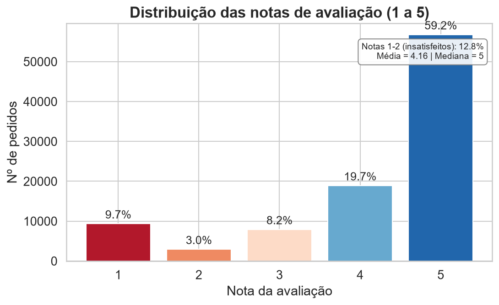

*Figura: Distribuição das notas de avaliação*

A nota do cliente varia de 1 (pior) a 5 (melhor). A maioria das avaliações é nota 5 e existem poucos extremos (notas 1-2, que definem a insatisfação no estudo). A distribuição é assimétrica à esquerda, o que justifica tratar a insatisfação como a classe 'notas 1-2 vs. notas 3-5'.
No tempo, a insatisfação oscila mês a mês: o pior mês da série foi **2018-03**
(21,1% de notas 1-2) e o melhor **2017-08**
(9,5%), o que sugere efeitos de sazonalidade/capacidade
a monitorar.
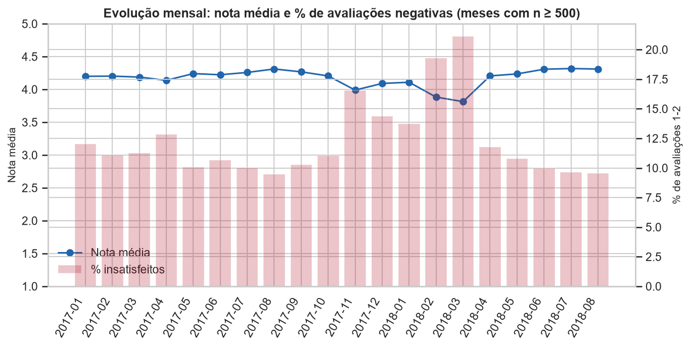

*Figura: Evolução mensal da nota média e da insatisfação*

Evolução mensal da nota média e da taxa de insatisfação (notas 1-2): mostra que a percepção dos clientes varia ao longo do tempo e pode conter efeitos sazonais/capacidade a monitorar.
Ainda na EDA: avaliações com comentário são **76,0%** entre insatisfeitos
vs. **37,4%** entre satisfeitos — evidência de que o cliente insatisfeito
tende a *se manifestar* (sinal útil para monitoramento, embora observado após a nota).
---
**Atraso.** A mediana do atraso piora conforme a nota cai: pedidos bem avaliados
chegam, na mediana, **12,2 dias antes** do prazo prometido,
enquanto os insatisfeitos têm apenas **7,2 dias de
antecedência** — e 33,7% deles ultrapassam o prazo de fato.
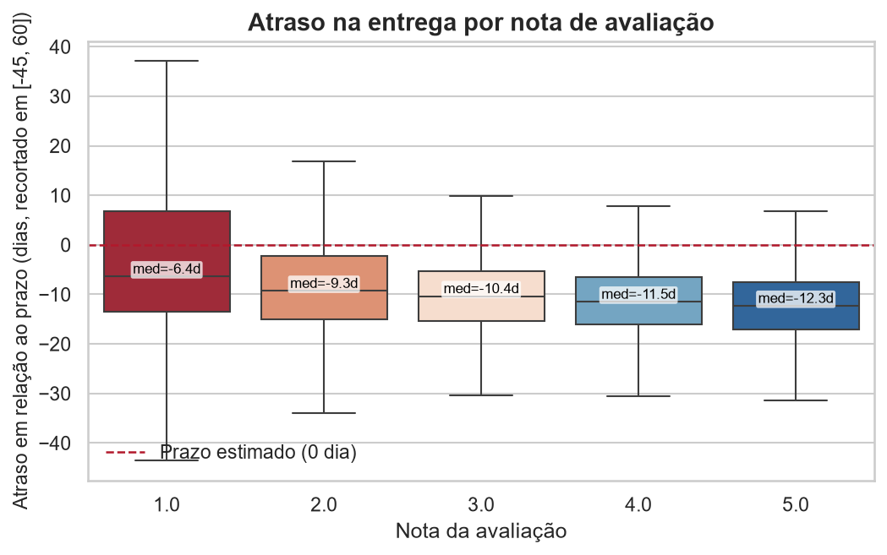

*Figura: Distribuição do atraso por nota de avaliação*

Atraso em dias por nota de avaliação: insatisfeitos tendem a ter atraso maior e a receber com menos antecedência em relação ao prazo prometido. Mostra a relação entre atraso e o desfecho avaliativo.
A taxa de insatisfação cresce de forma **monotônica nas quatro faixas**:
**9,0%** (adiantado > 7 dias),
**10,2%** (no prazo, até 7 dias antes),
**36,1%** (atraso de 1 a 7 dias) e
**78,4%** (atraso > 7 dias). Agrupando todos os
pedidos sem atraso, a taxa é 9,2%, contra
54,1% entre os atrasados.
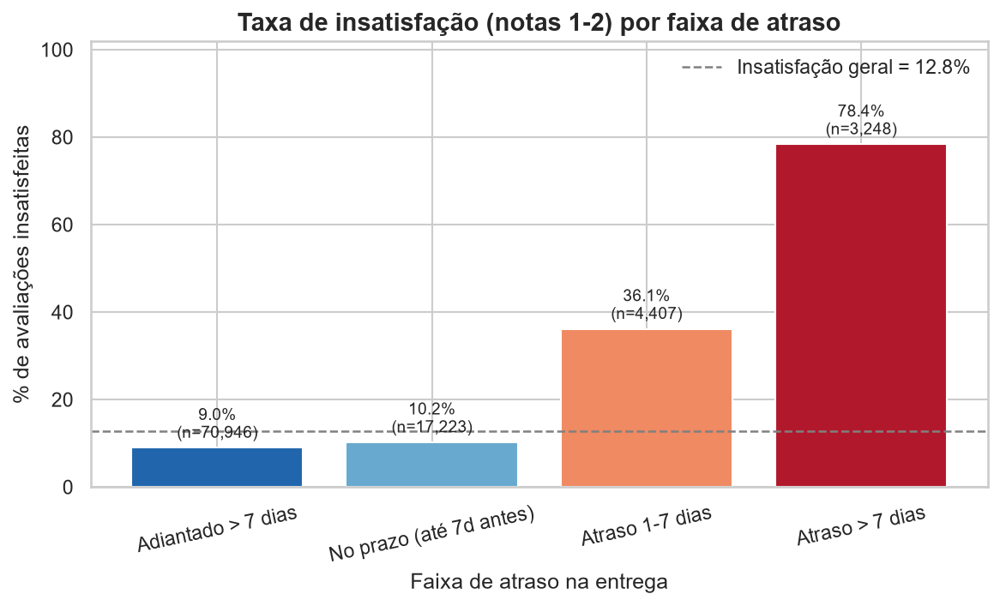

*Figura: Taxa de insatisfação por faixa de atraso*

Taxa de insatisfação (notas 1-2) por faixa de atraso: relação de dose-resposta — quanto maior o atraso, maior a probabilidade de insatisfação, de forma consistente nas quatro faixas.
**Pedidos com múltiplos itens.** Pedidos com **1 item** têm 11,3% de
insatisfação, contra **26,8% em pedidos com 2 ou mais itens**. A explicação por envios
fracionados é uma hipótese: o dataset não registra remessas por item, então ela precisa ser
verificada com dados de logística.
**Frete, preço e distância.** Insatisfeitos pagam frete mais alto
(mediana R$ 18,52 vs. R$ 16,94) e vêm de
pedidos mais distantes (480 km vs. 426 km),
mas os efeitos são **pequenos**; a *participação* do frete no pedido é praticamente
igual entre os grupos (mediana 18,9% vs. 18,3%).
O scatterplot abaixo mostra a relação dispersa entre distância e frete:
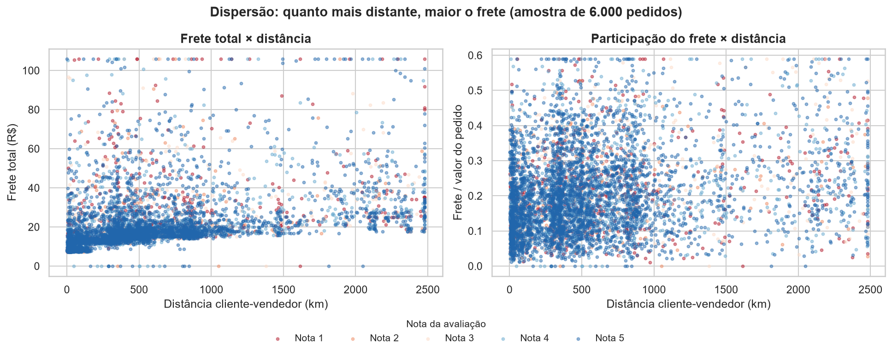

*Figura: Scatterplot: distância × frete total e × participação do frete*

Scatterplot da distância cliente-vendedor contra o frete total e contra a participação do frete no pedido, com a cor indicando a nota. Quanto maior a distância, maior o frete; a nota não forma faixas separadas, ou seja, a associação existe mas é fraca.
**Categorias e estados.** Os gráficos consideram só grupos com pelo menos 300
pedidos (taxas de grupos pequenos são instáveis; os intervalos de confiança estão em `tab03` e `tab04`):
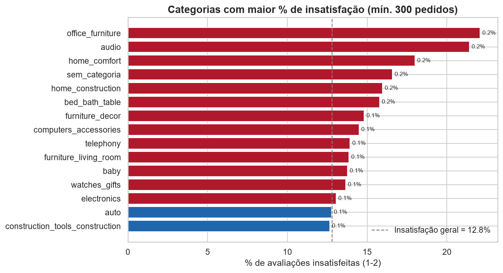

*Figura: Categorias com maior % de insatisfação*

Percentual de insatisfação por categoria de produto (categorias com mais pedidos). Compara a taxa de notas 1-2 com a média geral (12,8%) para indicar categorias críticas onde a insatisfação se concentra.
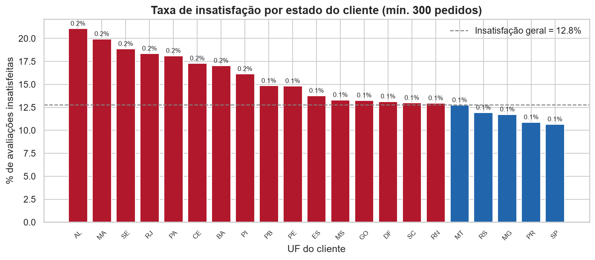

*Figura: Taxa de insatisfação por estado do cliente*

Taxa de insatisfação por estado do cliente: destaca estados com risco de insatisfação acima da média, apontando onde priorizar ações regionais.
**PCA (diagnóstico multivariado).** Para verificar se as variáveis numéricas são
realmente independentes entre si, aplicamos a análise de componentes principais (PCA):
os gráficos mostram onde o sinal cai para o ruído, quantos componentes são necessários
e o que cada um representa (ver `reports/tables/tab13_pca_variancia.csv` e
`tab14_pca_necessidade.csv`).
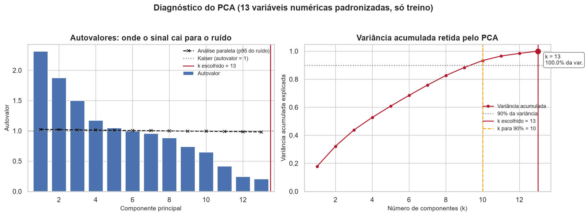

*Figura: Diagnóstico do PCA: autovalores e variância acumulada*

Diagnóstico do PCA: à esquerda os autovalores caem abaixo do ruído simulado (análise paralela) e do critério de Kaiser; à direita a variância acumulada mostra quantos componentes são necessários para reter a informação.
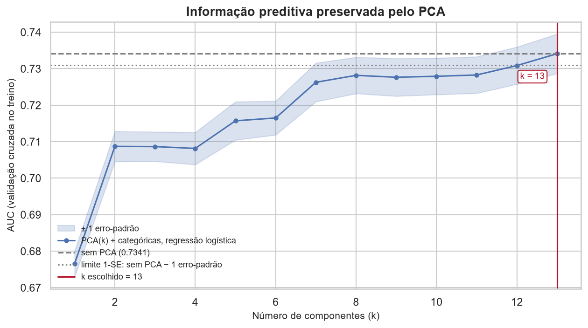

*Figura: Informação preditiva preservada pelo PCA em função de k*

AUC de validação cruzada em função do número de componentes k: compara o desempenho do PCA com o modelo sem PCA. O k escolhido é o menor k cujo desempenho permanece dentro de um erro-padrão do modelo sem PCA.
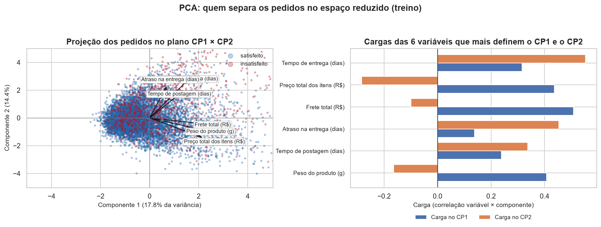

*Figura: Projeção no plano CP1 × CP2 e cargas das variáveis*

Projeção dos pedidos no plano dos dois primeiros componentes principais e as variáveis que mais definem esses eixos. Os dois grupos (satisfeito/insatisfeito) se sobrepõem no espaço reduzido, sinal de que o PCA sozinho não separa classes.
---
Com N ≈ 95.824, **pequenas diferenças se tornam "significativas"**; por isso
reportamos p-valor **e** tamanho de efeito. Hipóteses testadas (α = 0,05):
||---|---|---|---|---|---|
| 1 | Atraso (dias) — insatisfeitos x satisfeitos | Mann-Whitney U | 672843454.5 | < 1e-300 | correlação rank-bisserial (r) = 0.3133 |
| 2 | Tempo total de entrega (dias) | Mann-Whitney U | 702336842.0 | < 1e-300 | correlação rank-bisserial (r) = 0.3709 |
| 3 | Frete total (R$) | Mann-Whitney U | 596387722.0 | 7.18e-190 | correlação rank-bisserial (r) = 0.1641 |
| 4 | Participação do frete no pedido (%) | Mann-Whitney U | 524564383.5 | 1.86e-05 | correlação rank-bisserial (r) = 0.0239 |
| 5 | Valor do pedido (R$) | Mann-Whitney U | 566183785.0 | 4.20e-79 | correlação rank-bisserial (r) = 0.1051 |
| 6 | Nº de itens do pedido | Mann-Whitney U | 576676684.5 | < 1e-300 | correlação rank-bisserial (r) = 0.1256 |
| 7 | Distância cliente-vendedor (km) | Mann-Whitney U | 549061285.5 | 5.42e-49 | correlação rank-bisserial (r) = 0.0823 |
| 8 | Tempo até a postagem (dias) | Mann-Whitney U | 595831790.0 | 2.12e-196 | correlação rank-bisserial (r) = 0.1671 |
| 9 | Nota x atraso na entrega | Spearman (correlação de postos) | -0.1755 | < 1e-300 | rho de Spearman = -0.1755 |
| 10 | Nota x tempo total de entrega | Spearman (correlação de postos) | -0.2345 | < 1e-300 | rho de Spearman = -0.2345 |
| 11 | Nota x participação do frete | Spearman (correlação de postos) | -0.0306 | 2.46e-21 | rho de Spearman = -0.0306 |
| 12 | Nota x distância cliente-vendedor | Spearman (correlação de postos) | -0.0649 | 1.51e-89 | rho de Spearman = -0.0649 |
| 13 | Nota x valor do pedido | Spearman (correlação de postos) | -0.0395 | 1.77e-34 | rho de Spearman = -0.0395 |
| 14 | Cumprimento do prazo (sim/não) x insatisfação | Qui-quadrado de independência | 12688.16 | < 1e-300 | V de Cramér = 0.3639 |
| 15 | Categoria do produto x insatisfação | Qui-quadrado de independência | 472.99 | 1.02e-69 | V de Cramér = 0.0703 |
| 16 | UF do cliente x insatisfação | Qui-quadrado de independência | 719.71 | 5.31e-135 | V de Cramér = 0.0867 |
| 17 | Forma de pagamento x insatisfação | Qui-quadrado de independência | 6.39 | 9.40e-02 | V de Cramér = 0.0082 |
| 18 | Faixa de atraso x insatisfação | Qui-quadrado de independência | 15697.83 | < 1e-300 | V de Cramér = 0.4047 |
| 19 | Nota x faixa de atraso | Kruskal-Wallis | 9652.31 | < 1e-300 | epsilon² = 0.1007 |

**Leitura dos principais resultados**
* **Atraso e lentidão (efeitos moderados):** Mann-Whitney p < 0,001 com
  r = 0,313 no atraso (mediana
  -7,2 vs. -12,2 dias —
  insatisfeitos recebem com bem **menos antecedência**) e r = 0,371
  no tempo total de entrega (15,7 vs.
  9,9 dias).
* **Atraso × insatisfação (qui-quadrado + odds ratio):**
| medida                             | valor              |
|:-----------------------------------|:-------------------|
| Taxa de insatisfação — com atraso  | 54.06%             |
| Taxa de insatisfação — no prazo    | 9.21%              |
| Odds ratio (atrasado vs. no prazo) | 11.59              |
| IC 95% do odds ratio               | 11.02 – 12.19      |
| Risco relativo                     | 5.87x              |
| Qui-quadrado / p-valor             | 12688.2 / < 1e-300 |
  → ter atrasado multiplica por **11,6x** as chances de nota 1-2
  (54,1% de insatisfação entre atrasados vs.
  9,2% no prazo) — a maior associação entre as variáveis de prazo
  (V de Cramér = 0,364).
* **Categoria e UF** associam-se à insatisfação (qui-quadrado, p < 0,001), porém com
  **V de Cramér pequeno** (categoria = 0,070;
  UF = 0,087):
  efeitos reais, porém **diluídos** — servem para *onde* priorizar, não explicam o todo.
* **Forma de pagamento NÃO se associou** à insatisfação (p = 0,094;
  V = 0,008) — hipótese não rejeitada.
* **Correlações de Spearman** com a nota: atraso (ρ = -0,175) e
  tempo de entrega (ρ = -0,234)
  lideram; distância (ρ = -0,065),
  frete-ratio (ρ = -0,031) e
  valor (ρ = -0,040) têm
  associação **estatisticamente detectável, porém fraca**.
* **Kruskal-Wallis** entre faixas de atraso: p < 0,001 (epsilon² =
  0,1007).
_Tabelas completas:_ `reports/tables/tab05_testes_hipotese.csv` e `tab06_odds_ratio_atraso.csv`.
---
Os testes da Seção 5 medem associação univariada. Para decidir **quais variáveis manter**, a seleção foi feita
**só no treino**, com cinco métodos: dois filtros (informação mútua e AUC univariada), um wrapper (forward com
regressão logística) e dois embutidos (L1 e random forest). Todos pontuam as mesmas
19 features e comparam cada uma com **cópias embaralhadas dela mesma**
(features-sombra); a variável é selecionada se ao menos 3 de 5 métodos a escolhem. Critérios, custo do wrapper e
convergências estão no `relatorio_etapas.md` (Seção 3).
| Feature         | Tipo       |   Métodos que a selecionam (de 5) | MI com o alvo   | AUC univariada (CV)   | Selecionada   |
|:----------------|:-----------|----------------------------------:|:----------------|:----------------------|:--------------|
| entrega_dias    | numérica   |                                 5 | 0.0446          | 0.688                 | sim           |
| n_itens         | numérica   |                                 5 | 0.0121          | 0.562                 | sim           |
| atraso_dias     | numérica   |                                 4 | 0.0571          | 0.665                 | sim           |
| manuseio_dias   | numérica   |                                 4 | 0.0071          | 0.576                 | sim           |
| categoria_grupo | categórica |                                 4 | 0.0030          | 0.547                 | sim           |
| distancia_km    | numérica   |                                 4 | 0.0020          | 0.544                 | sim           |
| preco_total     | numérica   |                                 4 | 0.0064          | 0.543                 | sim           |
| mes_compra      | categórica |                                 3 | 0.0051          | 0.582                 | sim           |
| frete_total     | numérica   |                                 3 | 0.0057          | 0.577                 | sim           |
| uf_cliente      | categórica |                                 3 | 0.0036          | 0.554                 | sim           |
| peso_g          | numérica   |                                 3 | 0.0015          | 0.521                 | sim           |
| n_fotos         | numérica   |                                 2 | 0.0000          | 0.520                 | não           |
**Leitura**
1. **Selecionadas (11):** `entrega_dias`, `n_itens`, `atraso_dias`, `manuseio_dias`, `categoria_grupo`, `distancia_km`, `preco_total`, `mes_compra`, `frete_total`, `uf_cliente`, `peso_g`.
2. **Descartadas (8):** `n_fotos`, `n_parcelas`, `uf_vendedor`, `frete_ratio`, `aprovacao_h`, `pagamento_tipo`, `hora_compra`, `dia_semana_compra`.
3. **Pagamento:** `pagamento_tipo` é escolhida por 1 de 5 métodos,
   coerente com a Seção 5 (p = 0,094).
4. **Variáveis de pouco sinal:** `hora_compra` é escolhida por 1 e
   `aprovacao_h` por 1 de 5 métodos.
5. **Informação preservada:** treinar só com as selecionadas muda o AUC de teste em -0.0019 (regressão
   logística); o PCA não permitiu reduzir (o critério preditivo exigiu as 13 componentes, ou seja, só rotaciona as variáveis)
   (`reports/tables/tab16_comparacao_representacoes.csv`).
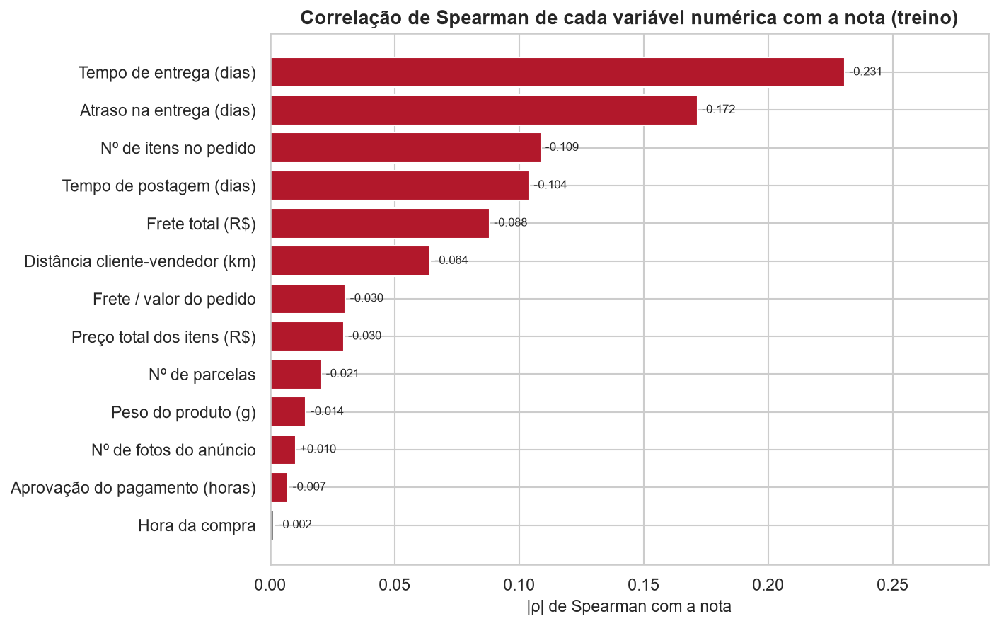

*Figura: Correlação de Spearman de cada variável numérica com a nota (treino)*

Ranking das variáveis numéricas pela correlação de Spearman com a nota — indica quais variáveis se relacionam mais com a insatisfação. Barras em vermelho têm p < 0,05.
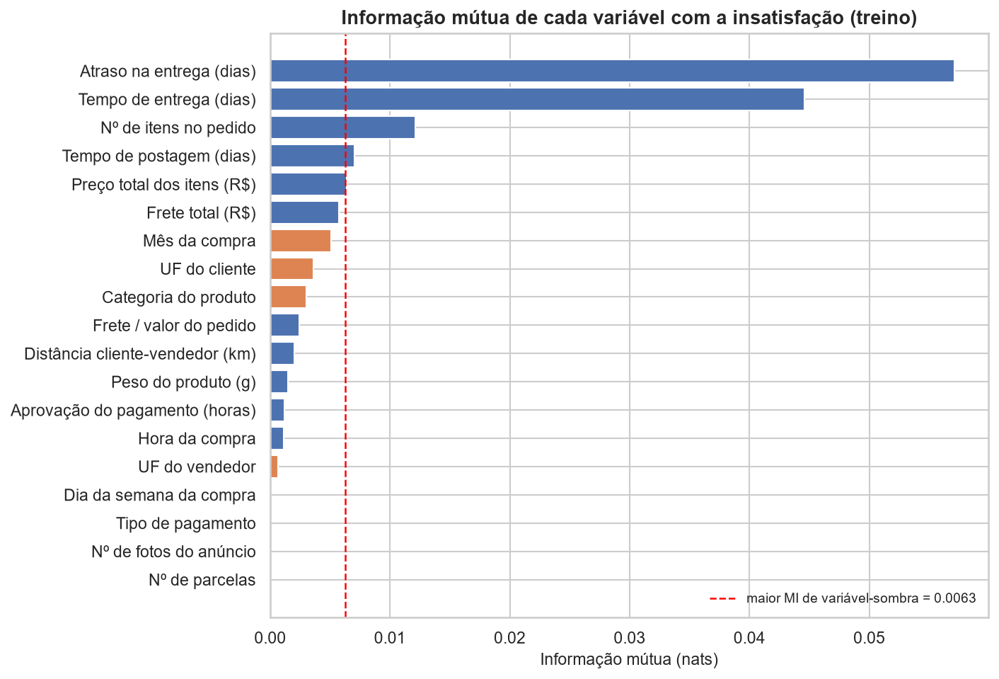

*Figura: Informação mútua com a insatisfação vs. variáveis-sombra*

Informação mútua entre cada variável e a insatisfação — medida de associação que não assume linearidade. A linha vermelha é o maior valor obtido por variáveis-sombra (ruído embaralhado): só o que passa dela carrega sinal real.
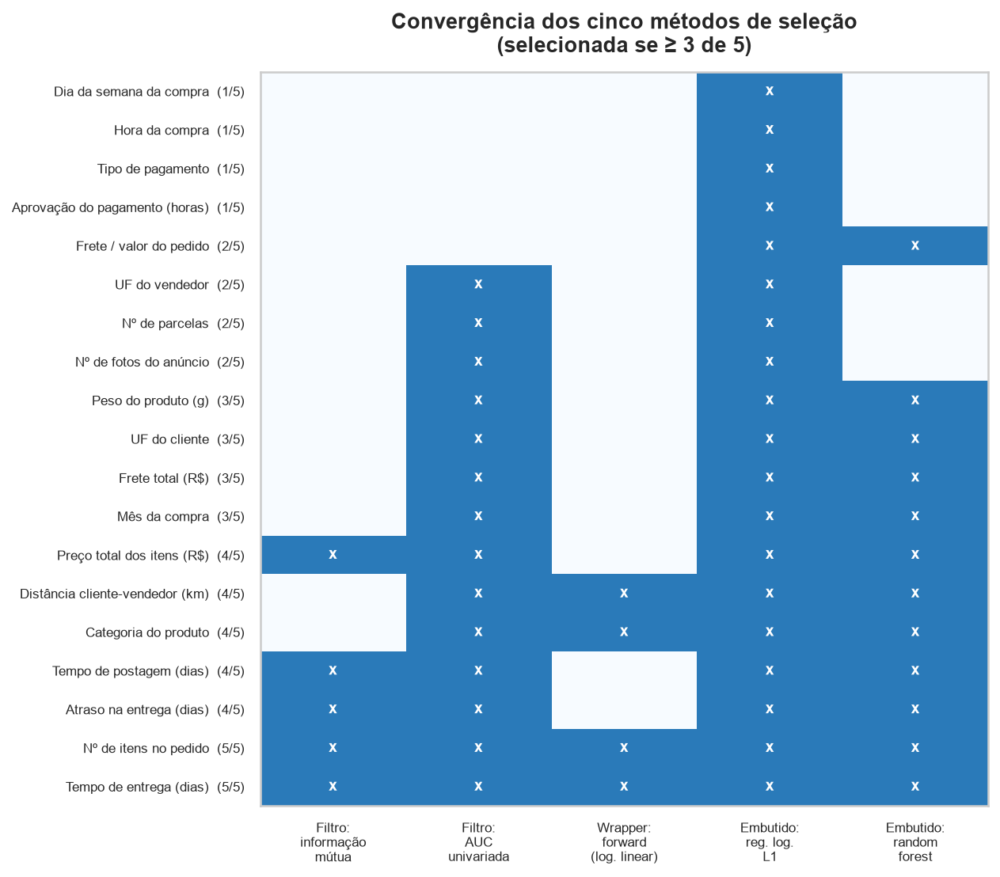

*Figura: Convergência dos cinco métodos de seleção*

Convergência dos cinco métodos de seleção (dois filtros, um wrapper e dois embutidos). Cada linha é uma variável e cada coluna um método; as variáveis marcadas em 3 ou mais de 5 métodos foram mantidas.
---
**Configuração:** separação estratificada 80/20 (a mesma usada na seleção e no PCA) e validação cruzada
estratificada (5 dobras) no treino. **Sem `class_weight`:** pesos de classe deslocam as probabilidades — numa
versão anterior com `class_weight='balanced'`, o modelo superestimava o risco e as probabilidades ficavam
piores que as de um preditor constante. O desbalanceamento (positivos = 12,8%) é tratado pelo
**limiar de decisão**, escolhido pelo F1 máximo nas previsões fora-da-dobra do treino. O melhor modelo é escolhido
pelo AUC de validação cruzada, não pelo teste. Features: 19 (operacionais +
categoria/UF/pagamento/calendário; **sem** texto de comentário, para evitar vazamento; `valor_pedido` e
`preco_unitario_medio` ficaram de fora por serem derivadas exatas de outras variáveis).
**Escolha dos modelos**
A regressão logística é o baseline interpretável: P(insatisfeito|X) = 1/(1+exp(−z)); seus coeficientes dão odds
ratios **condicionais** (ajustados pelas demais variáveis). O HistGradientBoosting captura não linearidades e
interações (por exemplo, o salto de probabilidade quando o atraso passa de zero) com árvores sequenciais que
minimizam a log-loss.
| Modelo | AUC (CV) | AUC (teste) | Acurácia | Precisão | Recall | F1 | Limiar |
|---|---|---|---|---|---|---|---|
| Regressão logística | 0.734±0.004 | 0.740 | 0.869 | 0.483 | 0.386 | 0.429 | 0.24 |
| Gradient boosting (HGB) | 0.760±0.005 | 0.765 | 0.872 | 0.502 | 0.453 | 0.476 | 0.23 |
*Métricas no teste (n = 19.165). Acurácia, precisão, recall e F1 usam o limiar escolhido na
validação cruzada (F1 máximo); a AUC é independente de limiar. Melhor modelo:
**gradient boosting** (salvo em `outputs/modelo_insatisfacao.joblib`).*
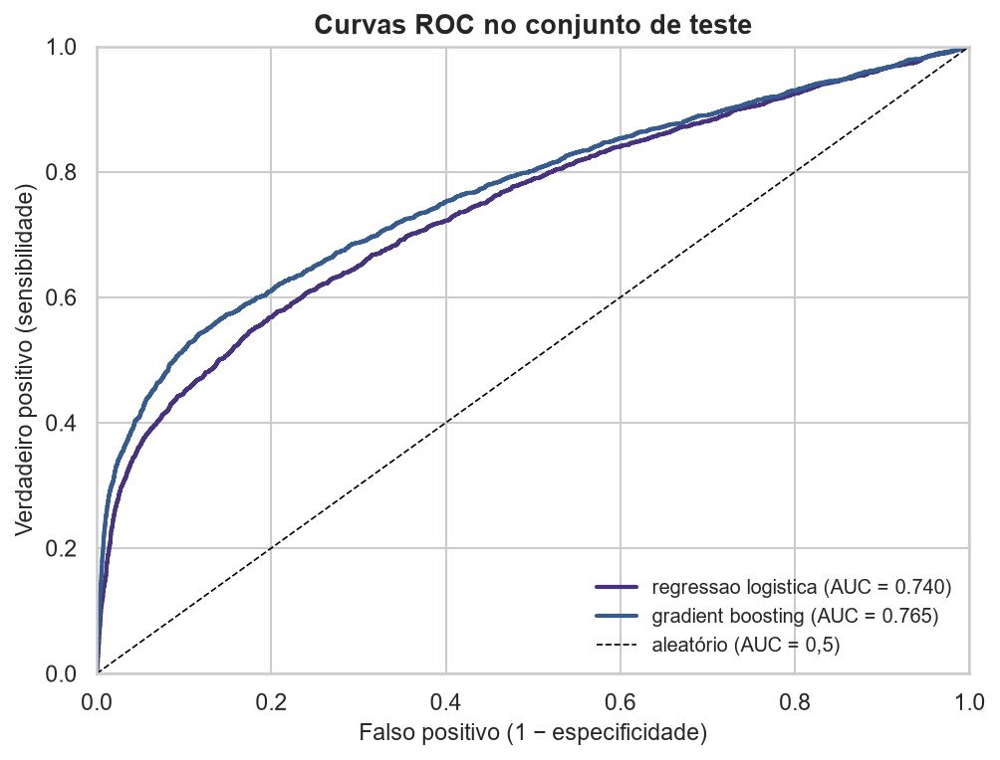

*Figura: Curvas ROC no conjunto de teste*

Curvas ROC (sensibilidade × 1-especificidade) no conjunto de teste: a AUC resume o poder discriminativo do modelo (quanto mais próximo de 1, melhor); a diagonal tracejada é o classificador aleatório (AUC = 0,5).
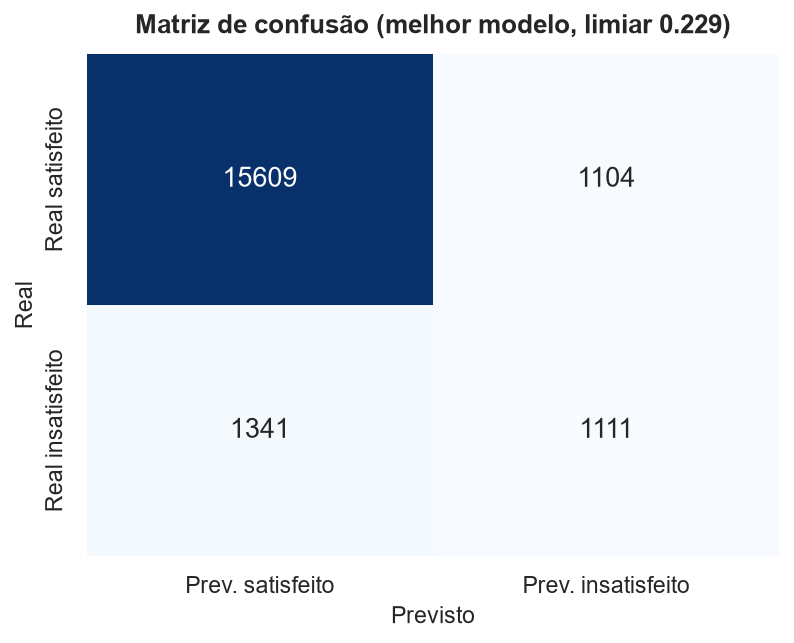

*Figura: Matriz de confusão do melhor modelo (limiar escolhido na validação cruzada)*

Matriz de confusão (real × previsto) com o limiar escolhido na validação cruzada: quantifica acertos (TN/TP) e erros (FP/FN); o recall (TP/(TP+FN)) mostra o quanto o modelo identificou os insatisfeitos.
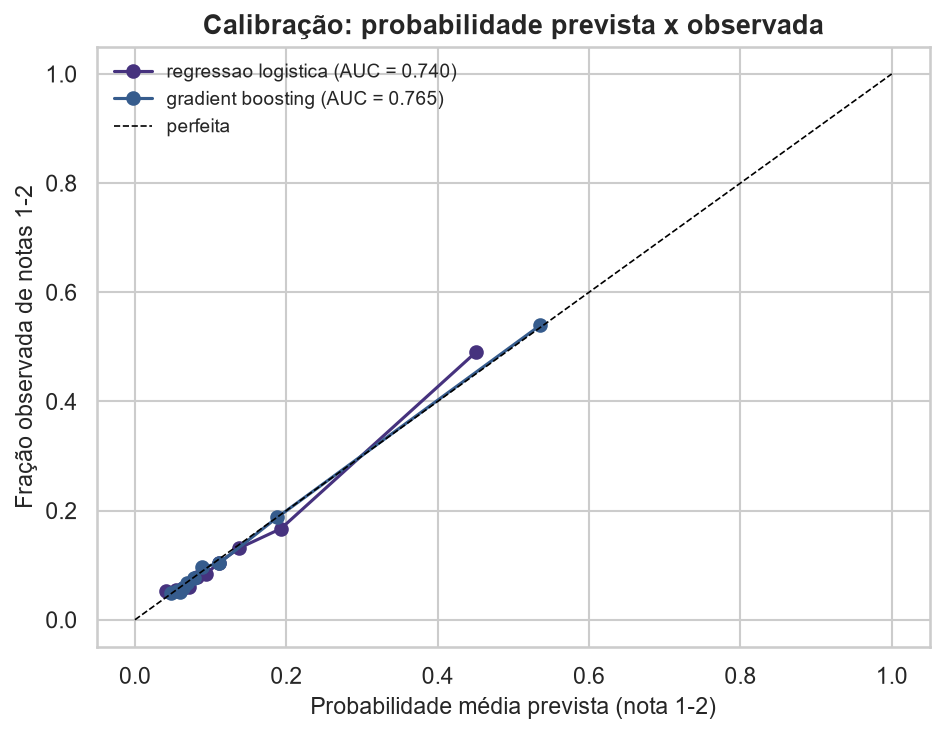

*Figura: Calibração das probabilidades previstas*

Curva de calibração: probabilidade prevista pelo modelo vs. frequência real observada. Se a curva acompanha a diagonal ideal, as probabilidades são confiáveis e podem ser usadas como score de risco.
**Calibração.** A curva de calibração acompanha a diagonal: a probabilidade média prevista é
13,0% contra 12,8% observada.
As probabilidades são utilizáveis como estimativa de risco por pedido.
**Validações adicionais**
| Cenário | AUC | Acurácia | Recall | F1 |
|---|---|---|---|---|
| Teste aleatório (principal) | 0,765 | 0,872 | 0,453 | 0,476 |
| Validação temporal (treina nos 80% mais antigos, testa nos 20% mais recentes) | 0,694 | 0,884 | 0,301 | 0,335 |
| Modelo pré-entrega (sem `atraso_dias` e `entrega_dias`, que só existem após a entrega) | 0,692 | 0,833 | 0,301 | 0,316 |
---
`odds_ratio > 1` → **aumenta** a chance de nota 1-2; `< 1` → **protege**. Para numéricos, o OR refere-se a 1
desvio-padrão. São odds ratios **ajustados pelas demais variáveis**: por isso o OR de `atraso_dias`
(1,29) é bem menor que o OR bruto de 11,6x, já que `entrega_dias`
(OR = 1,93), correlacionada com ela, absorve parte do efeito. Categorias com menos de
300 pedidos no treino ficam de fora (estimativas instáveis).
**Fatores que MAIS aumentam a insatisfação:**
| variavel                 |   odds_ratio | n_treino   |
|:-------------------------|-------------:|:-----------|
| entrega_dias             |         1.93 | —          |
| categoria: sem_categoria |         1.52 | 1.127      |
| categoria: home_comfort  |         1.49 | 313        |
| n_itens                  |         1.36 | —          |
| mes_compra_2017-01       |         1.34 | 571        |
| UF cliente: RJ           |         1.33 | 9.734      |
**Fatores protetores:**
| variavel                          |   odds_ratio | n_treino   |
|:----------------------------------|-------------:|:-----------|
| categoria: books_general_interest |         0.43 | 383        |
| UF vendedor: GO                   |         0.52 | 366        |
| pagamento: boleto                 |         0.65 | 15.172     |
| categoria: stationery             |         0.68 | 1.777      |
| pagamento: debit_card             |         0.68 | 1.191      |
| pagamento: credit_card            |         0.69 | 57.949     |
*Tabela completa:* `reports/tables/tab07_odds_ratios_logistica.csv`.
**Por variável (permutação individual):** queda do AUC no teste ao embaralhar uma coluna
(10 repetições). Atenção: variáveis correlacionadas **dividem o crédito** (embaralhar `atraso_dias` ainda deixa
`entrega_dias` informar o modelo), então variáveis independentes parecem relativamente mais importantes.
||---|---|---|---|
| 1 | n_itens | 0.0569 | ±0.0022 |
| 2 | atraso_dias | 0.0444 | ±0.0014 |
| 3 | entrega_dias | 0.0343 | ±0.0036 |
| 4 | categoria_grupo | 0.0138 | ±0.0016 |
| 5 | manuseio_dias | 0.0067 | ±0.0016 |
| 6 | distancia_km | 0.0036 | ±0.0010 |
| 7 | uf_vendedor | 0.0026 | ±0.0007 |
| 8 | preco_total | 0.0022 | ±0.0005 |
**Por grupo (permutação conjunta):** as colunas de cada grupo são embaralhadas juntas, o que elimina a
divisão de crédito entre variáveis correlacionadas.
| Grupo                        | Variáveis do grupo                             | Queda média de AUC   | Desvio   |
|:-----------------------------|:-----------------------------------------------|:---------------------|:---------|
| Prazo e tempo de entrega     | atraso_dias, entrega_dias, manuseio_dias       | 0.1953               | ±0.0062  |
| Pedido (itens, preço, frete) | n_itens, preco_total, frete_total, frete_ratio | 0.0622               | ±0.0032  |
| Produto                      | categoria_grupo, peso_g, n_fotos               | 0.0157               | ±0.0019  |
| Geografia                    | uf_cliente, uf_vendedor, distancia_km          | 0.0064               | ±0.0013  |
| Calendário                   | mes_compra, dia_semana_compra, hora_compra     | 0.0003               | ±0.0008  |
| Pagamento e aprovação        | pagamento_tipo, n_parcelas, aprovacao_h        | -0.0001              | ±0.0006  |
No SHAP agregado por variável, **`atraso_dias`** lidera e `n_itens` ocupa a posição 2.

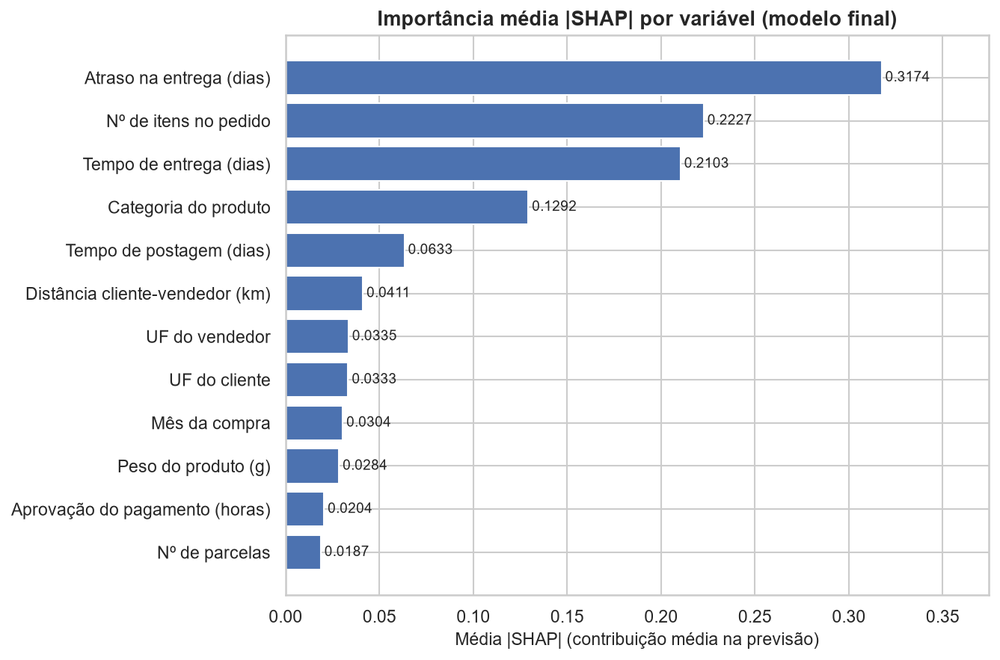

*Figura: Importância média |SHAP| por variável*

Importância média |SHAP| por variável: contribuição média de cada variável para as decisões do modelo — baseada nos valores de Shapley, que distribuem o 'crédito' de forma justa entre as variáveis.

1. **Pontualidade da entrega (atraso vs. prometido)** — associação *univariada* mais forte:
   11,6x mais chances de nota 1-2 com atraso e relação dose-resposta
   (9,0% → 78,4%
   nas faixas). O grupo "Prazo e tempo de entrega" é o **   0,195).
2. **Tempo total de entrega** — efeito Mann-Whitney de r = 0,37:
   15,7 dias (insatisfeitos) vs. 9,9 dias
   (satisfeitos); OR condicional = 1,9 por desvio-padrão.
3. **Pedidos com múltiplos itens** — associação bruta de 11,3% (1 item) contra
   26,8% (2+). Na permutação individual `n_itens` ocupa a posição 1 de
   19, mas isso exagera sua importância relativa: `atraso_dias` e `entrega_dias` dividem o crédito
   entre si. Na permutação por grupo, "Prazo e tempo de entrega" (queda de AUC 0,195) pesa
   3,1x mais que "Pedido (itens, preço, frete)"
   (0,062,   grupo mais importante), mas **a causa** (envios fracionados) segue como hipótese a verificar.
4. **Categoria do produto** (com ao menos 300 pedidos no treino) — maior OR: `sem_categoria`
   (1,5x); maior efeito protetor: `books_general_interest` (0,43x).
5. **Frete total e distância** — associação **consistente, porém pequena**
   (r = 0,16 e
   0,08);
   a *participação* do frete no pedido é praticamente nula (r =
   0,02).
6. **Manuseio (compra → postagem)** — efeito pequeno (permutação 0,007;
   r = 0,17).
7. **UF do cliente** — moderador de efeito pequeno (V = 0,09).
8. **O que NÃO explica a nota:** a **forma de pagamento** não teve associação (p = 0,094).
---
**R1 — Gestão ativa do prazo prometido (prioridade máxima).**
Com 11,6x mais chances de insatisfação em atrasos e 33,7% dos
insatisfeitos terem recebido com atraso, a alavanca de maior retorno é: (i) revisar o *prometido x executado* por
rota/transportadora, (ii) negociar prazos realistas com os vendedores/regiões mais lentos e (iii) **avisar o
cliente quando o atraso for provável**. Atenção a (iii): o escore do modelo principal usa `atraso_dias` e
`entrega_dias`, que só existem **depois** da entrega, então não serve para o aviso antecipado. O modelo pré-entrega
(sem essas variáveis, mas com `manuseio_dias`, conhecido na postagem) tem AUC = 0,692,
contra 0,765 do modelo completo: serve como triagem, mas não prevê o atraso em si. O aviso antecipado
confiável exige dados de rastreio/ETA que não fazem parte do dataset.
**R2 — Investigar os pedidos com múltiplos itens (hipótese a verificar).**
Pedidos com 2+ itens têm 26,8% de insatisfação contra 11,3% com 1 item. A
importância desse fator no modelo depende da métrica (permutação individual: posição 1 de
19; grupo "Pedido": posição 2 de 6). Antes de agir, confirmar com dados de
logística se há envios fracionados/vários vendedores; se confirmado, rastrear remessas item a item, unificar o
envio quando possível e comunicar proativamente quando uma parte atrasar.
**R3 — Auditar categorias críticas (com amostra suficiente: n ≥ 300).**
* **office_furniture**: 22,1% (IC95% 19,9%–24,5%; n=1.241)
* **audio**: 21,4% (IC95% 17,4%–26,1%; n=341)
* **home_comfort**: 18,0% (IC95% 14,5%–22,1%; n=389)
* **sem_categoria**: 16,6% (IC95% 14,7%–18,6%; n=1.369)
* **home_construction**: 16,0% (IC95% 12,9%–19,5%; n=470)
Auditar vendedores, embalagem e prazos dessas categorias e comparar com a média geral (12,8%).
Intervalos que incluem a média geral indicam diferença ainda não confirmada.
**R4 — Frete: alavanca secundária (não priorizar sobre prazo).**
Insatisfeitos pagam frete um pouco mais alto (mediana R$ 18,52 vs.
R$ 16,94), mas o efeito é **pequeno** e a participação do frete no pedido é igual entre
grupos; portanto, frete grátis isolado não resolve a insatisfação. Atuar apenas onde ele se cruza com atraso (rotas longas).
**R5 — Monitoramento contínuo por região e tempo.**
* Maiores taxas (n ≥ 300):
  * **AL**: 21,1% (IC95% 17,3%–25,4%; n=394)
  * **MA**: 19,9% (IC95% 17,2%–23,0%; n=712)
  * **SE**: 18,9% (IC95% 15,0%–23,4%; n=334)
* Maior excesso de insatisfeitos em volume (insatisfeitos observados − esperados pela taxa geral):
  * **RJ**: 678 pedidos a mais (taxa 18,4%; n=12.211)
  * **BA**: 136 pedidos a mais (taxa 17,0%; n=3.229)
  * **CE**: 57 pedidos a mais (taxa 17,3%; n=1.273)
* Pior mês 2018-03 vs. melhor mês 2017-08 (meses com n ≥ 500) — planejar capacidade nas janelas de pico.
**R6 — Usar o escore para priorizar o atendimento pós-entrega.**
Com AUC ≈ 0,76: (a) calcular o escore **no momento da entrega**, quando atraso e tempo
realizados já são conhecidos; (b) acionar atendimento proativo para pedidos acima do limiar
(0,23, escolhido pelo F1 em validação cruzada; no teste dá precisão
0,50 e recall 0,45), ajustando-o à capacidade da equipe; e
(c) *fechar o ciclo*, acompanhando a taxa de nota 1-2 dos pedidos atendidos. As probabilidades são utilizáveis como estimativa de risco por pedido.
**R7 — Escuta ativa pós-entrega.**
76,0% dos insatisfeitos escrevem comentário. Tratar comentários negativos como *sinal de alerta
secundário* (monitoramento de reputação); o alerta mais barato continua sendo o atraso.
---
* **Associação ≠ causalidade:** dados observacionais; confundidores possíveis (categoria × vendedor × região) —
  próximo passo: modelos com efeitos aleatórios ou experimentação (ex.: teste de promessa de prazo).
* **Escore pós-entrega:** o desempenho usa o atraso realizado. Sem ele (pré-entrega) o AUC é
  0,692; antecipar o atraso exige dados de rastreio/ETA.
* **Estabilidade temporal:** na validação temporal o AUC é 0,694 contra
  0,765 no teste aleatório; `mes_compra` captura eventos pontuais (ex.: fev–mar/2018) e
  meses novos entram como categoria desconhecida. A queda é relevante: o modelo **não** deve ser assumido estável; retreinar e recalibrar periodicamente.
* **Amostras pequenas:** categorias e UFs com menos de 300 pedidos ficam fora dos rankings; os IC95%
  completos estão em `tab03` e `tab04`.
* **Dados e regras de limpeza:** valores impossíveis (datas incoerentes, distância fora do Brasil etc.) foram
  tratados como ausentes; a unificação de categorias `_2` é hipótese de domínio (`relatorio_etapas.md`, Seções 1 e 7).
* **Sem conteúdo textual:** comentários não entram no modelo (vazamento); NLP pode somar na triagem.
* **Sem info de devoluções/logística reversa** no dataset.
* Próximos passos: recalibrar probabilidades se forem usadas como risco absoluto; adicionar tempo-de-vida do
  cliente (recompra) e avaliação por item; segmentar o escore por transportadora.
```bash
pip install -r requirements.txt
python run_pipeline.pypython run_pipeline.py --etapa eda```
*Dados:* Kaggle — `olistbr/brazilian-ecommerce` (baixados automaticamente via `kagglehub` ou em `data/raw/`).
*Seed:* 42.
**Artefatos:** `../reports/figures/` (27 figuras) ·
`reports/tables/` (25 tabelas) · `outputs/prep/` (base pré-processada, treino e teste) ·
`outputs/resultados_modelo.json` · `outputs/modelo_insatisfacao.joblib`.
