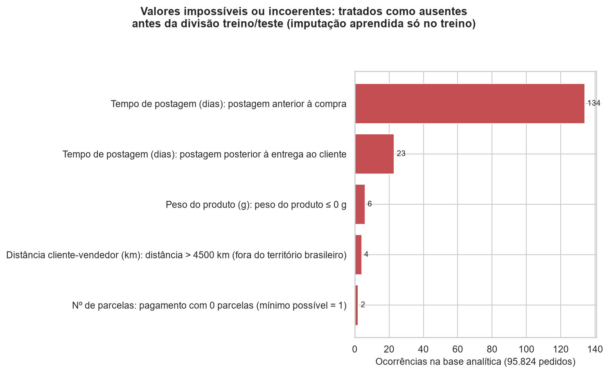
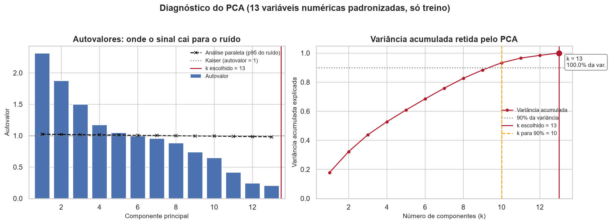
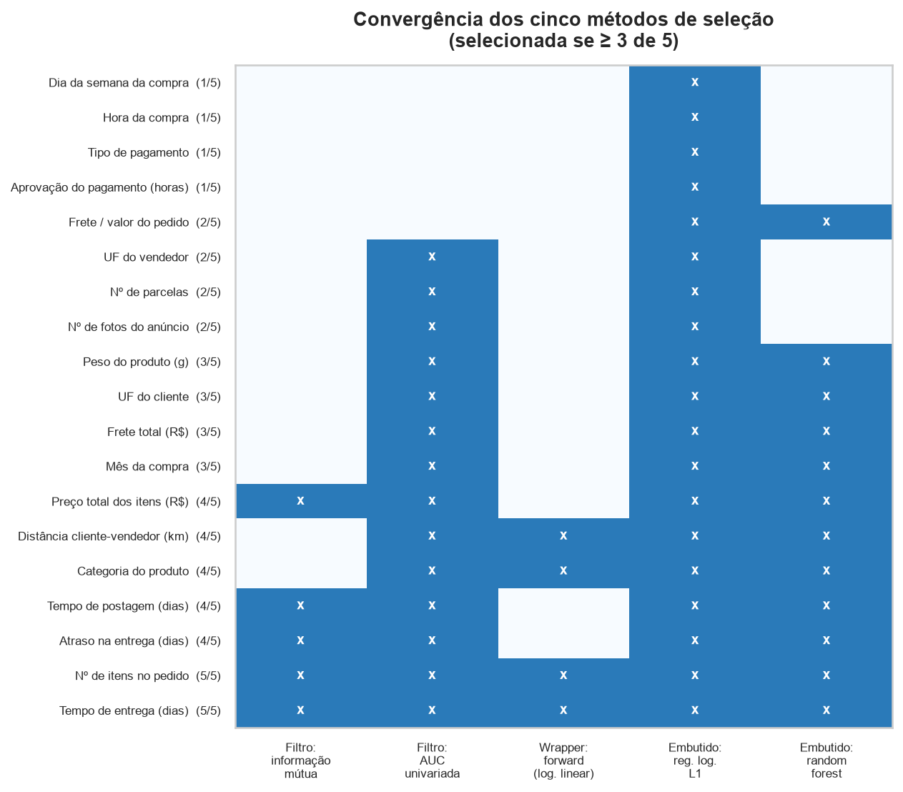
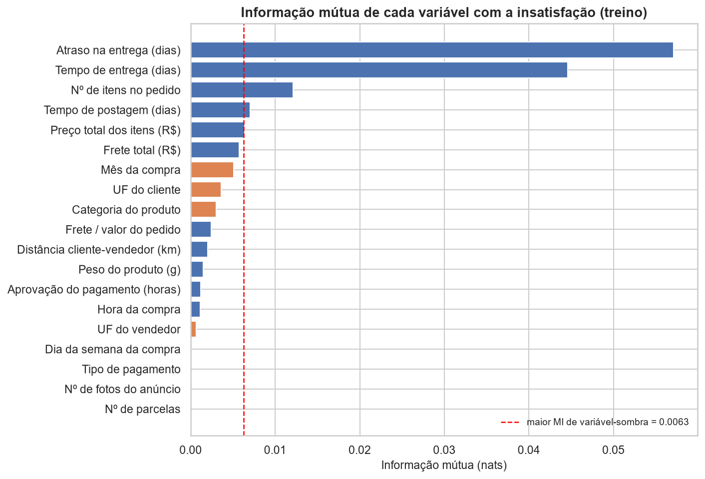
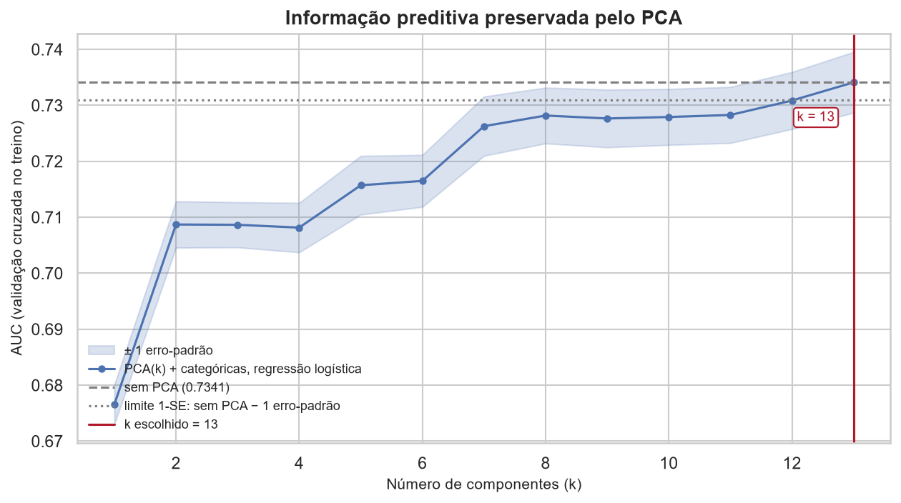
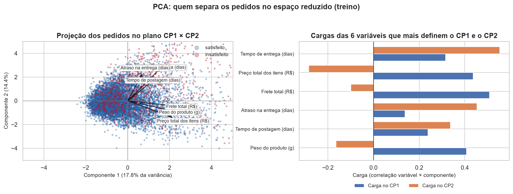
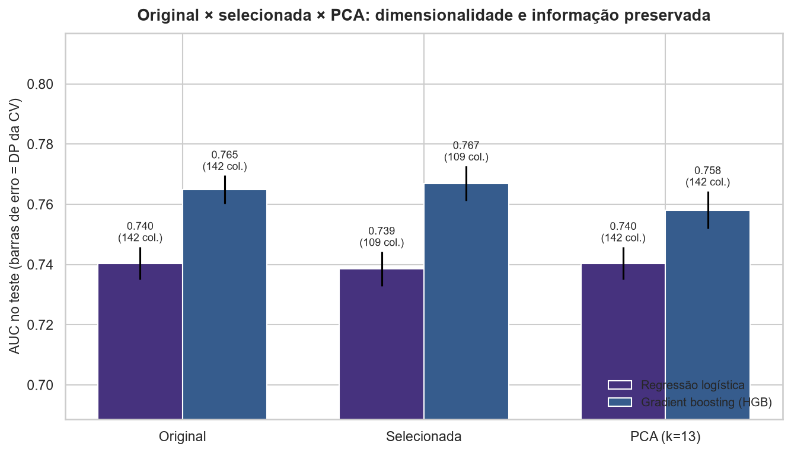
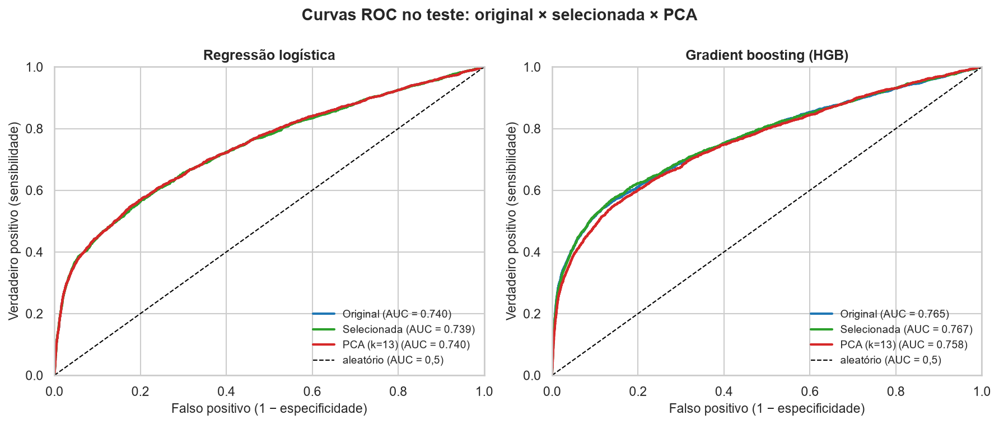
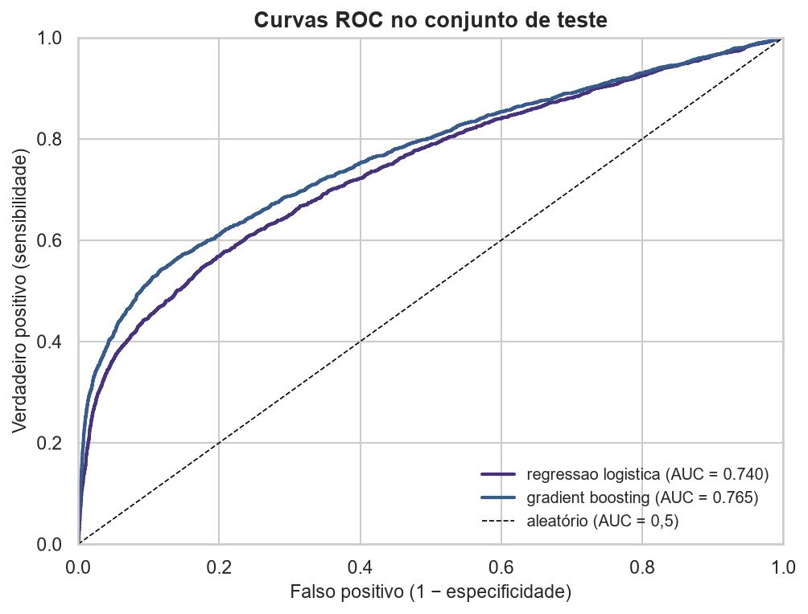
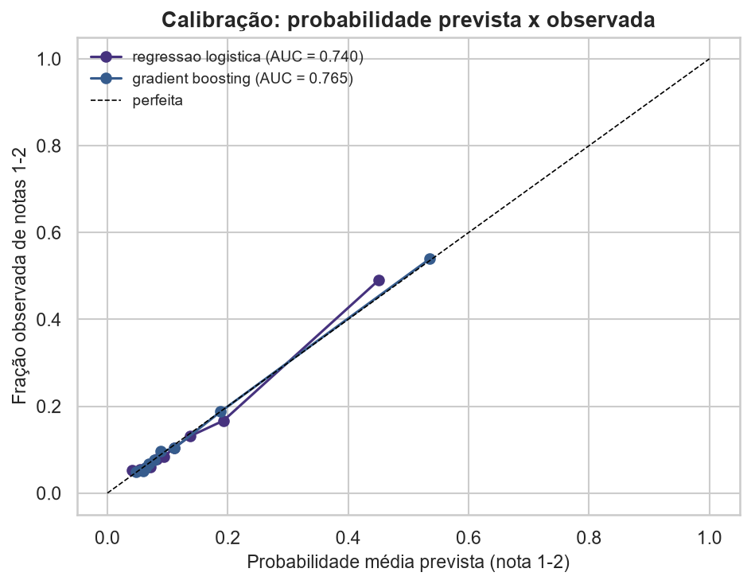

# Relatório de etapas — preparação, redução de dimensionalidade e modelo
**Dataset:** [Olist Brazilian E-commerce](https://www.kaggle.com/datasets/olistbr/brazilian-ecommerce)
(tema substituído pelo trabalho final da equipe, conforme a OBS da atividade).
> **Pergunta central:** *como preparar e reduzir a base de dados preservando a informação
> relevante para as etapas seguintes?*
>
> **Regra aplicada a todo o relatório:** toda transformação responde *"que problema nos
> dados a justifica?"* e toda redução responde *"que informação é preservada e o que é perdido?"*.
**Protocolo anti-vazamento:** a divisão treino/teste ocorre antes de qualquer ajuste.
Imputação, escala, seleção de atributos, PCA, limiar de decisão e escolha do modelo usam
**somente o treino** (76.659 pedidos); o teste (19.165) é
usado uma única vez para a avaliação final.
| Seção | Conteúdo |
|---|---|
| 1 | Diagnóstico inicial da base |
| 2 | Decisões de pré-processamento |
| 3 | Seleção de atributos (filtro, wrapper, embutido) |
| 4 | PCA |
| 5 | Comparação das representações |
| 6 | Modelo final e avaliação |
| 7 | Limitações e decisões que mudariam com novo conhecimento de domínio |
---
| tabela               | linhas    |   colunas |
|:---------------------|:----------|----------:|
| orders               | 99.441    |         8 |
| customers            | 99.441    |         5 |
| items                | 112.650   |         7 |
| reviews              | 99.224    |         7 |
| payments             | 103.886   |         5 |
| products             | 32.951    |         9 |
| sellers              | 3.095     |         4 |
| geolocation          | 1.000.163 |         5 |
| category_translation | 71        |         2 |
Após o recorte (pedidos entregues, com data de entrega e uma avaliação por pedido — a mais antiga),
a base tem **95.824 pedidos × 42 colunas**
(21 features candidatas). Taxa do alvo (`review_score ≤ 2`):
**12,8%**. A lista completa de verificações está em
`reports/tables/tab15_diagnostico_qualidade.csv`.
| item           | n     | pct   | decisao                       | justificativa                                 |
|:---------------|:------|:------|:------------------------------|:----------------------------------------------|
| manuseio_dias  | 1     | 0,00% | imputar pela mediana (treino) | ausência residual (< 0,1%)                    |
| aprovacao_h    | 14    | 0,01% | imputar pela mediana (treino) | ausência residual (< 0,1%)                    |
| distancia_km   | 475   | 0,50% | imputar pela mediana (treino) | CEP sem coordenadas na base de geolocalização |
| n_parcelas     | 1     | 0,00% | imputar pela mediana (treino) | ausência residual (< 0,1%)                    |
| peso_g         | 16    | 0,02% | imputar pela mediana (treino) | ausência residual (< 0,1%)                    |
| n_fotos        | 1.349 | 1,41% | imputar pela mediana (treino) | produto sem cadastro de fotos; MCAR plausível |
| pagamento_tipo | 1     | 0,00% | imputar pela moda (treino)    | ausência pontual, categoria dominante         |
| item                                    | n   | pct   | decisao      | justificativa                                                                                         |
|:----------------------------------------|:----|:------|:-------------|:------------------------------------------------------------------------------------------------------|
| order_id repetido                       | 0   | 0,00% | nenhuma ação | granularidade = 1 pedido por linha (revisões duplicadas tratadas em features.py)                      |
| linhas idênticas nas features (sem ids) | 0   | 0,00% | mantidas     | pedidos distintos (order_id únicos) podem coincidir em todas as features; sem evidência de duplicação |
| item                                                 | decisao                   | justificativa                                      |
|:-----------------------------------------------------|:--------------------------|:---------------------------------------------------|
| costruction_tools_garden → construction_tools_garden | unificadas em features.py | erro de grafia no dicionário de categorias         |
| home_confort → home_comfort                          | unificadas em features.py | erro de grafia no dicionário de categorias         |
| home_comfort_2 → home_comfort                        | unificadas em features.py | versão '_2' da mesma família (hipótese de domínio) |
| home_appliances_2 → home_appliances                  | unificadas em features.py | versão '_2' da mesma família (hipótese de domínio) |
| fashio_female_clothing → fashion_female_clothing     | unificadas em features.py | erro de grafia no dicionário de categorias         |
| item                                                              | n   | pct   | decisao                       |
|:------------------------------------------------------------------|:----|:------|:------------------------------|
| manuseio_dias: postagem anterior à compra                         | 134 | 0,14% | → NaN e imputação pelo treino |
| manuseio_dias: postagem posterior à entrega ao cliente            | 23  | 0,02% | → NaN e imputação pelo treino |
| entrega_dias: entrega anterior ou igual à compra                  | 0   | 0,00% | nenhuma ocorrência            |
| aprovacao_h: aprovação anterior à compra                          | 0   | 0,00% | nenhuma ocorrência            |
| n_parcelas: pagamento com 0 parcelas (mínimo possível = 1)        | 2   | 0,00% | → NaN e imputação pelo treino |
| peso_g: peso do produto ≤ 0 g                                     | 6   | 0,01% | → NaN e imputação pelo treino |
| distancia_km: distância > 4500 km (fora do território brasileiro) | 4   | 0,00% | → NaN e imputação pelo treino |
| preco_total: preço total ≤ 0                                      | 0   | 0,00% | nenhuma ocorrência            |
| frete_total: frete negativo                                       | 0   | 0,00% | nenhuma ocorrência            |
| n_itens: pedido sem itens                                         | 0   | 0,00% | nenhuma ocorrência            |

*Figura: Valores impossíveis ou incoerentes: tratados como ausentes antes da divisão treino/teste*

Valores impossíveis ou incoerentes detectados nas regras de domínio (datas invertidas, distância fora do Brasil, preço zero). Foram transformados em ausentes antes da divisão treino/teste, para que a imputação seja aprendida só no treino.
Critério: fora de 3×IQR **e** avaliado pelo domínio e pela coerência com outras variáveis.
Extremos coerentes (entregas de 100+ dias em pedidos muito atrasados e mal avaliados, itens caros
com frete proporcional) **foram mantidos**; só viraram erro os valores que violam o domínio (1.3).
| item                                                                     | decisao                               | justificativa                                                                 |
|:-------------------------------------------------------------------------|:--------------------------------------|:------------------------------------------------------------------------------|
| atraso_dias (> 3×IQR: 620 sup. / 204 inf.; 78% de 1-2 no top 1%)         | mantidos (legítimo)                   | atrasos longos coerentes com entrega_dias e com notas baixas                  |
| entrega_dias (> 3×IQR: 1341 sup. / 0 inf.; 77% de 1-2 no top 1%)         | mantidos (legítimo)                   | entregas > 60 dias existem na operação e quase sempre estão atrasadas         |
| manuseio_dias (> 3×IQR: 2195 sup. / 0 inf.; 51% de 1-2 no top 1%)        | mantidos (legítimo na cauda positiva) | negativos já tratados como inválidos; cauda positiva = vendedor lento         |
| aprovacao_h (> 3×IQR: 3647 sup. / 0 inf.; 15% de 1-2 no top 1%)          | mantidos (legítimo)                   | boletos aprovados após vários dias                                            |
| frete_total (> 3×IQR: 4857 sup. / 0 inf.; 27% de 1-2 no top 1%)          | mantidos (legítimo)                   | itens pesados/volumosos e rotas longas; frete é coerente com peso e distância |
| preco_total (> 3×IQR: 3897 sup. / 0 inf.; 19% de 1-2 no top 1%)          | mantidos (legítimo)                   | itens de alto valor existem no marketplace; preço = soma dos itens do pedido  |
| valor_pedido (> 3×IQR: 3804 sup. / 0 inf.; 19% de 1-2 no top 1%)         | mantidos (legítimo (redundante))      | soma de preço e frete; extremos são pedidos caros e coerentes com preco_total |
| frete_ratio (> 3×IQR: 66 sup. / 0 inf.; 17% de 1-2 no top 1%)            | mantidos (legítimo)                   | pedidos baratos com frete alto (razão alta) são esperados                     |
| preco_unitario_medio (> 3×IQR: 3565 sup. / 0 inf.; 17% de 1-2 no top 1%) | mantidos (legítimo (redundante))      | preço médio dos itens; extremos são itens caros                               |
| distancia_km (> 3×IQR: 589 sup. / 0 inf.; 16% de 1-2 no top 1%)          | mantidos (legítimo até o limite)      | acima do limite geográfico = erro de coordenada (tratado)                     |
| n_parcelas (> 3×IQR: 161 sup. / 0 inf.; 20% de 1-2 no top 1%)            | mantidos (legítimo)                   | parcelamentos longos (até 24x) são possíveis                                  |
| peso_g (> 3×IQR: 9456 sup. / 0 inf.; 17% de 1-2 no top 1%)               | mantidos (legítimo)                   | móveis e eletrodomésticos pesados (até ~40 kg)                                |
| n_fotos (> 3×IQR: 475 sup. / 0 inf.; 14% de 1-2 no top 1%)               | mantidos (legítimo)                   | anúncios com muitas fotos                                                     |
| Coluna                        | Critério      | Motivo                                                                    |
|:------------------------------|:--------------|:--------------------------------------------------------------------------|
| order_id                      | identificador | identificador único do pedido (1:1 com a linha)                           |
| customer_id                   | identificador | chave de ligação pedido-cliente                                           |
| order_status                  | constante     | após o recorte todos os pedidos são 'delivered'                           |
| order_purchase_timestamp      | engenharia    | substituída por hora_compra, mes_compra, dia_semana_compra                |
| order_approved_at             | engenharia    | substituída por aprovacao_h                                               |
| order_delivered_carrier_date  | engenharia    | substituída por manuseio_dias                                             |
| order_delivered_customer_date | engenharia    | substituída por entrega_dias                                              |
| order_estimated_delivery_date | engenharia    | substituída por atraso_dias (real − prometido)                            |
| customer_unique_id            | identificador | identificador de cliente (alta cardinalidade)                             |
| cep_cliente                   | identificador | identificador geográfico fino (equivalente à cidade)                      |
| cidade_cliente                | identificador | alta cardinalidade; informação geográfica já em uf_cliente e distancia_km |
| categoria                     | redundância   | versão sem agrupamento de categoria_grupo                                 |
| seller_zip                    | identificador | identificador geográfico do vendedor                                      |
| valor_pago                    | redundância   | equivalente a valor do pedido (preço + frete) já representado             |
| review_score                  | vazamento     | o alvo é derivado dela                                                    |
| review_creation_date          | vazamento     | conhecida só depois da avaliação                                          |
| tem_comentario                | vazamento     | faz parte da própria avaliação                                            |
| comentario_chars              | vazamento     | faz parte da própria avaliação                                            |
| valor_pedido                  | redundância   | identidade exata: preco_total + frete_total                               |
| preco_unitario_medio          | redundância   | derivada: preco_total / n_itens                                           |
| prazo_cumprido                | redundância   | binarização de atraso_dias                                                |
| faixa_atraso                  | redundância   | discretização de atraso_dias (usada só na EDA)                            |
| item                                                                          | decisao                    | justificativa                                                |
|:------------------------------------------------------------------------------|:---------------------------|:-------------------------------------------------------------|
| preco_total × valor_pedido (r = 0.996)                                        | ver decisão abaixo         | correlação linear muito alta                                 |
| preco_total × preco_unitario_medio (r = 0.932)                                | ver decisão abaixo         | correlação linear muito alta                                 |
| valor_pedido × preco_unitario_medio (r = 0.920)                               | ver decisão abaixo         | correlação linear muito alta                                 |
| identidade: valor_pedido = preco_total + frete_total (desvio máx. = 0.00)     | variável derivada removida | contém exatamente a mesma informação das variáveis originais |
| identidade: preco_unitario_medio = preco_total / n_itens (desvio máx. = 0.01) | variável derivada removida | contém exatamente a mesma informação das variáveis originais |
| remoção de valor_pedido                                                       | descartada do modelo       | identidade exata: preco_total + frete_total                  |
| remoção de preco_unitario_medio                                               | descartada do modelo       | derivada: preco_total / n_itens (r > 0,9 com preco_total)    |
| Variável             | VIF antes   | VIF depois   |
|:---------------------|:------------|:-------------|
| atraso_dias          | 2,0         | 2,0          |
| entrega_dias         | 2,7         | 2,7          |
| manuseio_dias        | 1,3         | 1,3          |
| aprovacao_h          | 1,1         | 1,1          |
| frete_total          | >1.000.000  | 2,5          |
| preco_total          | >1.000.000  | 1,7          |
| valor_pedido         | >1.000.000  | removida     |
| frete_ratio          | 1,5         | 1,5          |
| n_itens              | 1,9         | 1,4          |
| preco_unitario_medio | 11,5        | removida     |
| distancia_km         | 1,8         | 1,8          |
| n_parcelas           | 1,2         | 1,2          |
| peso_g               | 1,7         | 1,7          |
| n_fotos              | 1,0         | 1,0          |
| hora_compra          | 1,0         | 1,0          |
*Interpretação:* `valor_pedido` é exatamente `preco_total + frete_total` e `preco_unitario_medio`
é `preco_total / n_itens`; foram removidas porque são 100% reconstruíveis. `atraso_dias` e
`entrega_dias` têm correlação alta, mas **medem coisas diferentes** (o atraso depende do prazo
prometido) e foram mantidas; o efeito dessa colinearidade é tratado nas importâncias por **grupo** (Seção 6).
---
| Transformação                                                                 | Problema que a justifica                                                                                                                   | Resultado                                                          |
|:------------------------------------------------------------------------------|:-------------------------------------------------------------------------------------------------------------------------------------------|:-------------------------------------------------------------------|
| Recorte analítico (entregues, com avaliação)                                  | Sem entrega ou sem avaliação não há alvo observável                                                                                        | 99.441 → 95.824 pedidos                                            |
| Unificação de categorias equivalentes                                         | Grafias/versões duplicadas (ex.: `home_confort`/`home_comfort_2`) fragmentam níveis                                                        | 5 regras (hipótese de domínio, ver Seção 7)                        |
| Valores impossíveis → ausente                                                 | Datas incoerentes, parcelas = 0, peso = 0, distância fora do Brasil                                                                        | 169 valores                                                        |
| Remoção de variáveis derivadas                                                | Identidades exatas / colinearidade extrema (VIF)                                                                                           | VIF máx. > 1.000.000 → 2,7; `valor_pedido`, `preco_unitario_medio` |
| Descarte de identificadores, constantes e vazamento                           | Não generalizam ou usam informação posterior ao alvo                                                                                       | 22 colunas                                                         |
| Divisão treino/teste estratificada (80/20) **antes** de qualquer ajuste       | Evitar que o teste influencie imputação, escala, seleção, PCA e limiar                                                                     | 76.659 / 19.165; positivos 12,8% / 12,8%                           |
| Imputação por mediana (numéricas) e moda (categóricas), ajustada só no treino | Ausências residuais e valores tratados como inválidos                                                                                      | 2.026 células a imputar                                            |
| One-hot com `min_frequency=30`                                                | Categóricas nominais (sem ordem); níveis raros geram colunas instáveis                                                                     | 6 variáveis → 129 colunas                                          |
| Padronização (z-score) só para regressão logística e PCA                      | Modelos lineares e PCA são sensíveis à escala; árvores não                                                                                 | 13 numéricas                                                       |
| Sem `class_weight` nem reamostragem                                           | Pesos de classe distorcem as probabilidades; o desbalanceamento (12,8% de positivos) é tratado pelo limiar escolhido por validação cruzada | limiar do melhor modelo = 0,23                                     |
**Base final pré-processada** (treino e teste separados), em `outputs/prep/`:
`X_train_prep.csv.gz` (76.659 × 142), `X_test_prep.csv.gz`
(19.165 × 142), `y_train.csv`, `y_test.csv` e as versões limpas antes
da codificação (`treino_limpo.csv.gz`, `teste_limpo.csv.gz`).
**PCA (diagnóstico multivariado).** Para avaliar se as variáveis numéricas carregam informação redundante entre si, aplicamos a análise de componentes principais (PCA): o gráfico abaixo mostra os autovalores contra o ruído simulado e a variância acumulada pelos componentes.

*Figura: Diagnóstico do PCA: autovalores e variância acumulada*

Diagnóstico do PCA: à esquerda os autovalores caem abaixo do ruído simulado (análise paralela) e do critério de Kaiser; à direita a variância acumulada mostra quantos componentes são necessários para reter a informação.
O diagnóstico orienta a etapa seguinte de seleção/preprocessamento.
---
Para não comparar medidas incomparáveis entre numéricas e categóricas, **todos os métodos pontuam as
mesmas 19 features** (categóricas como bloco) e usam o treino. O corte não é um número fixo
de variáveis: cada método compara a feature com **cópias embaralhadas dela mesma (features-sombra)**,
que têm a mesma distribuição e nenhuma relação com o alvo.
| Método            | Critério de corte                                                   |   Nº selecionadas |
|:------------------|:--------------------------------------------------------------------|------------------:|
| Filtro: MI        | MI > maior MI entre features-sombra (colunas embaralhadas)          |                 5 |
| Filtro: AUC univ. | AUC univariada (CV 3) > maior AUC de feature-sombra                 |                14 |
| Wrapper: forward  | forward com regressão logística; para quando o ganho de AUC < 0.002 |                 4 |
| Embutido: L1      | coeficiente ≠ 0 com C = 0.3 (menor C a 1 erro-padrão do melhor)     |                19 |
| Embutido: RF      | importância (Gini) > maior importância de feature-sombra            |                12 |
| Feature           | Tipo       | Filtro: MI   | Filtro: AUC univ.   | Wrapper: forward   | Embutido: L1   | Embutido: RF   |   Nº métodos | Selecionada   |
|:------------------|:-----------|:-------------|:--------------------|:-------------------|:---------------|:---------------|-------------:|:--------------|
| entrega_dias      | numérica   | sim          | sim                 | sim                | sim            | sim            |            5 | **sim**       |
| n_itens           | numérica   | sim          | sim                 | sim                | sim            | sim            |            5 | **sim**       |
| atraso_dias       | numérica   | sim          | sim                 | —                  | sim            | sim            |            4 | **sim**       |
| manuseio_dias     | numérica   | sim          | sim                 | —                  | sim            | sim            |            4 | **sim**       |
| categoria_grupo   | categórica | —            | sim                 | sim                | sim            | sim            |            4 | **sim**       |
| distancia_km      | numérica   | —            | sim                 | sim                | sim            | sim            |            4 | **sim**       |
| preco_total       | numérica   | sim          | sim                 | —                  | sim            | sim            |            4 | **sim**       |
| mes_compra        | categórica | —            | sim                 | —                  | sim            | sim            |            3 | **sim**       |
| frete_total       | numérica   | —            | sim                 | —                  | sim            | sim            |            3 | **sim**       |
| uf_cliente        | categórica | —            | sim                 | —                  | sim            | sim            |            3 | **sim**       |
| peso_g            | numérica   | —            | sim                 | —                  | sim            | sim            |            3 | **sim**       |
| n_fotos           | numérica   | —            | sim                 | —                  | sim            | —              |            2 | não           |
| n_parcelas        | numérica   | —            | sim                 | —                  | sim            | —              |            2 | não           |
| uf_vendedor       | categórica | —            | sim                 | —                  | sim            | —              |            2 | não           |
| frete_ratio       | numérica   | —            | —                   | —                  | sim            | sim            |            2 | não           |
| aprovacao_h       | numérica   | —            | —                   | —                  | sim            | —              |            1 | não           |
| pagamento_tipo    | categórica | —            | —                   | —                  | sim            | —              |            1 | não           |
| hora_compra       | numérica   | —            | —                   | —                  | sim            | —              |            1 | não           |
| dia_semana_compra | categórica | —            | —                   | —                  | sim            | —              |            1 | não           |

*Figura: Convergência dos métodos de seleção*

Convergência dos cinco métodos de seleção (dois filtros, um wrapper e dois embutidos). Cada linha é uma variável e cada coluna um método; as variáveis marcadas em 3 ou mais de 5 métodos foram mantidas.
* **Unânimes (5/5):** `entrega_dias`, `n_itens`.
* **Maioria (3–4/5):** `atraso_dias`, `manuseio_dias`, `categoria_grupo`, `distancia_km`, `preco_total`, `mes_compra`, `frete_total`, `uf_cliente`, `peso_g`.
* **Divergentes (1–2/5):** `n_fotos`, `n_parcelas`, `uf_vendedor`, `frete_ratio`, `aprovacao_h`, `pagamento_tipo`, `hora_compra`, `dia_semana_compra`.
* **Rejeitadas por todos:** —.
* **Custo:** o wrapper exigiu **85 ajustes** de regressão
  logística (7 s), contra um único cálculo por variável nos
  filtros; o resultado depende do modelo usado (linear) e do critério de parada.
* **L1 sem poder de corte:** com o C escolhido o L1 manteve **todas** as variáveis; ele concorda com o consenso por construção, e a seleção efetiva vem dos outros quatro métodos.
* **Dependência do modelo:** o embutido L1 (linear) e o random forest (não linear) nem sempre concordam;
  variáveis com efeito só não linear ou em interação tendem a aparecer no RF e não no L1.
* **Associação descritiva:** `reports/tables/tab12_ranking_features.csv` traz também Spearman
  (numéricas) e V de Cramér corrigido (categóricas), calculados no treino.

*Figura: Informação mútua vs. ruído (features-sombra)*

Informação mútua entre cada variável e a insatisfação — medida de associação que não assume linearidade. A linha vermelha é o maior valor obtido por variáveis-sombra (ruído embaralhado): só o que passa dela carrega sinal real.
---
PCA ajustado **só no treino**, sobre as **13 numéricas padronizadas**. Não se retém
componentes "até atingir X% da variância": os critérios abaixo são comparados e a escolha final é validada
pela **informação preditiva preservada**.
| Componente   | Autovalor   | Var. explicada   | Var. acumulada   | Limiar análise paralela (p95)   | Kaiser (>1)   | Acima do ruído   |
|:-------------|:------------|:-----------------|:-----------------|:--------------------------------|:--------------|:-----------------|
| PC1          | 2,32        | 17,8%            | 17,8%            | 1,02                            | sim           | sim              |
| PC2          | 1,87        | 14,4%            | 32,2%            | 1,02                            | sim           | sim              |
| PC3          | 1,50        | 11,5%            | 43,7%            | 1,01                            | sim           | sim              |
| PC4          | 1,17        | 9,0%             | 52,8%            | 1,01                            | sim           | sim              |
| PC5          | 1,05        | 8,1%             | 60,8%            | 1,01                            | sim           | sim              |
| PC6          | 1,00        | 7,7%             | 68,5%            | 1,00                            | —             | —                |
| PC7          | 0,96        | 7,4%             | 75,8%            | 1,00                            | —             | —                |
| PC8          | 0,89        | 6,8%             | 82,6%            | 1,00                            | —             | —                |

*Figura: Diagnóstico do PCA: autovalores, análise paralela e variância acumulada*

Diagnóstico do PCA: à esquerda os autovalores caem abaixo do ruído simulado (análise paralela) e do critério de Kaiser; à direita a variância acumulada mostra quantos componentes são necessários para reter a informação.
| Critério                                    |   k |
|:--------------------------------------------|----:|
| Kaiser (autovalor > 1)                      |   5 |
| Análise paralela (acima do ruído)           |   5 |
| 90% da variância (apenas referência)        |  10 |
| Validação cruzada preditiva (1 erro-padrão) |  13 |
* Critérios puramente de variância divergem (5 a
  10 componentes): alta variância não implica
  relevância para o alvo.
* Pela validação cruzada preditiva (regressão logística com PCA(k) + categóricas), o menor k cujo AUC fica a
  1 erro-padrão do modelo **sem** PCA é **k = 13** (100,0% da
  variância; AUC 0.7341 contra 0.7341 sem PCA). Com
  k = 10 (regra dos 90%) o AUC seria 0.7279.
* **Conclusão:** com k = p = 13 o PCA apenas rotaciona as variáveis; **nenhuma redução é justificada** neste problema. Reduzir para k = 10 (regra dos 90%) custaria 0,0062 de AUC, porque parte do sinal preditivo está em componentes de baixa variância.

*Figura: Informação preditiva preservada pelo PCA em função de k*

AUC de validação cruzada em função do número de componentes k: compara o desempenho do PCA com o modelo sem PCA. O k escolhido é o menor k cujo desempenho permanece dentro de um erro-padrão do modelo sem PCA.
| Componente   | Variância   | Maiores cargas (sinal)                                                                                  | AUC da CP isolada vs. alvo   |
|:-------------|:------------|:--------------------------------------------------------------------------------------------------------|:-----------------------------|
| PC1          | 17,8%       | Frete total (R$) (+0.51), Preço total dos itens (R$) (+0.44), Peso do produto (g) (+0.41)               | 0,666                        |
| PC2          | 14,4%       | Tempo de entrega (dias) (+0.55), Atraso na entrega (dias) (+0.45), Tempo de postagem (dias) (+0.34)     | 0,639                        |
| PC3          | 11,5%       | Frete / valor do pedido (+0.58), Frete total (R$) (+0.37), Atraso na entrega (dias) (-0.37)             | 0,447                        |
| PC4          | 9,0%        | Aprovação do pagamento (horas) (+0.60), Distância cliente-vendedor (km) (-0.46), Nº de parcelas (-0.37) | 0,489                        |
| PC5          | 8,1%        | Nº de fotos do anúncio (+0.63), Nº de itens no pedido (-0.42), Aprovação do pagamento (horas) (+0.37)   | 0,404                        |
Tabela completa de cargas: `reports/tables/tab18_pca_cargas.csv`.

*Figura: Projeção no plano CP1 × CP2 e cargas das variáveis*

Projeção dos pedidos no plano dos dois primeiros componentes principais e as variáveis que mais definem esses eixos. Os dois grupos (satisfeito/insatisfeito) se sobrepõem no espaço reduzido, sinal de que o PCA sozinho não separa classes.
A componente mais associada ao alvo isoladamente é **PC1**
(AUC = 0,666). Se a nuvem CP1 × CP2
não separa as classes, é porque o PCA maximiza variância e **não** usa o alvo: o sinal de atraso pode
estar em componentes de baixa variância.
---
Mesmos modelos, mesma divisão, mesma validação. As três representações: **Original** (19
features), **Selecionada** (11 features do consenso) e **PCA** (13
componentes no lugar das 13 numéricas, mais as categóricas, ou seja, sem redução).
| Representação   | Modelo              |   Colunas no modelo | AUC CV (treino)   | AUC teste   | Acurácia   | Precisão   | Recall   | F1     | Limiar   | Δ AUC vs. original   |
|:----------------|:--------------------|--------------------:|:------------------|:------------|:-----------|:-----------|:---------|:-------|:---------|:---------------------|
| Original        | regressão logística |                 142 | 0.7341±0.0055     | 0.7404      | 0.8612     | 0.4525     | 0.4042   | 0.4270 | 0.23     | +0.0000              |
| Original        | gradient boosting   |                 142 | 0.7599±0.0047     | 0.7649      | 0.8757     | 0.5166     | 0.4441   | 0.4776 | 0.24     | +0.0000              |
| Selecionada     | regressão logística |                 109 | 0.7336±0.0057     | 0.7386      | 0.8637     | 0.4622     | 0.3985   | 0.4279 | 0.23     | -0.0019              |
| Selecionada     | gradient boosting   |                 109 | 0.7582±0.0058     | 0.7669      | 0.8742     | 0.5094     | 0.4511   | 0.4785 | 0.23     | +0.0020              |
| PCA             | regressão logística |                 142 | 0.7341±0.0054     | 0.7404      | 0.8604     | 0.4496     | 0.4074   | 0.4275 | 0.22     | +0.0000              |
| PCA             | gradient boosting   |                 142 | 0.7487±0.0062     | 0.7581      | 0.8644     | 0.4679     | 0.4372   | 0.4520 | 0.23     | -0.0068              |

*Figura: Dimensionalidade e informação preservada*

AUC no teste para as três representações (original, selecionada e PCA) nos dois modelos, com o número de colunas de cada uma: mostra o custo em desempenho da redução de dimensionalidade.

*Figura: Curvas ROC no teste: original × selecionada × PCA*

Curvas ROC no teste comparando as três representações dentro de cada modelo: as curvas praticamente se sobrepõem, o que confirma que a seleção de variáveis e o PCA preservam a informação preditiva.
**Informação preservada e perdida**
* **Selecionada:** Δ AUC de -0.0019 (regressão logística) e
  +0.0020 (boosting) com 11 de
  19 features. Mantém a interpretabilidade: continuam valendo OR e SHAP por variável.
* **PCA:** Δ AUC de +0.0000 (regressão logística) e
  -0.0068 (boosting). Com todas as componentes retidas, a regressão logística é idêntica à original (rotação não muda o ajuste linear) e o boosting piora, porque as árvores perdem os eixos originais; **não há ganho de dimensionalidade e há perda de interpretabilidade**.
* **Seleção × extração:** a seleção descarta variáveis inteiras e preserva o significado das que ficam; o PCA
  mistura todas as numéricas, o que só compensa com colinearidade forte e sem interesse em interpretar por
  variável. Depois de remover as redundâncias exatas, a colinearidade restante é moderada
  (VIF máx. 2,7).
---
Divisão estratificada 80/20; validação cruzada de 5 dobras no treino para comparar modelos e escolher o
limiar (F1 máximo nas previsões fora-da-dobra). **Melhor modelo: `gradient_boosting`** (maior AUC de CV; não é
escolhido pelo teste).
| Modelo              | AUC CV      | AUC teste   | Acurácia   | Precisão   | Recall   | F1    | Limiar   |
|:--------------------|:------------|:------------|:-----------|:-----------|:---------|:------|:---------|
| regressão logística | 0.734±0.004 | 0.740       | 0.869      | 0.483      | 0.386    | 0.429 | 0.24     |
| gradient boosting   | 0.760±0.005 | 0.765       | 0.872      | 0.502      | 0.453    | 0.476 | 0.23     |
*Métricas no teste (limiar = 0,23, escolhido na validação cruzada pelo F1 máximo).
Acurácia, precisão, recall e F1 usam esse limiar; AUC é independente de limiar.*
**Matriz de confusão (gradient boosting, limiar 0,23):** 15609 TN, 1104 FP,
1341 FN, 1111 TP.

*Figura: Curvas ROC no conjunto de teste*

Curvas ROC (sensibilidade × 1-especificidade) no conjunto de teste: a AUC resume o poder discriminativo do modelo (quanto mais próximo de 1, melhor); a diagonal tracejada é o classificador aleatório (AUC = 0,5).

*Figura: Calibração das probabilidades previstas*

Curva de calibração: probabilidade prevista pelo modelo vs. frequência real observada. Se a curva acompanha a diagonal ideal, as probabilidades são confiáveis e podem ser usadas como score de risco.
**Importância por grupo de variáveis (gradient boosting, queda de AUC no teste).** As colunas de um grupo
são permutadas juntas; isso evita subestimar variáveis correlacionadas (ex.: `atraso_dias` e `entrega_dias`)
e superestimar variáveis independentes.
| Grupo                        | Variáveis do grupo                             | Queda de AUC     |
|:-----------------------------|:-----------------------------------------------|:-----------------|
| Prazo e tempo de entrega     | atraso_dias, entrega_dias, manuseio_dias       | 0.1953 ± 0.0062  |
| Pedido (itens, preço, frete) | n_itens, preco_total, frete_total, frete_ratio | 0.0622 ± 0.0032  |
| Produto                      | categoria_grupo, peso_g, n_fotos               | 0.0157 ± 0.0019  |
| Geografia                    | uf_cliente, uf_vendedor, distancia_km          | 0.0064 ± 0.0013  |
| Calendário                   | mes_compra, dia_semana_compra, hora_compra     | 0.0003 ± 0.0008  |
| Pagamento e aprovação        | pagamento_tipo, n_parcelas, aprovacao_h        | -0.0001 ± 0.0006 |
**Validações adicionais**
| Cenário | AUC | Acurácia | Recall | F1 |
|---|---|---|---|---|
| Teste aleatório (principal) | 0,765 | 0,872 | 0,453 | 0,476 |
| Validação temporal (treina nos 80% mais antigos, testa nos 20% mais recentes) | 0,694 | 0,884 | 0,301 | 0,335 |
| Modelo pré-entrega (sem `atraso_dias` e `entrega_dias`) | 0,692 | 0,833 | 0,301 | 0,316 |
---
* **Unificação de categorias** (`home_appliances_2` → `home_appliances`, `home_comfort_2` → `home_comfort`):
  é hipótese de domínio (versões da mesma família). Se forem linhas de produto distintas, deve ser revertida.
* **Limites de validade:** distância > 4.500 km e "postagem após a entrega" foram tratadas como
  erro. Se `order_delivered_carrier_date` tiver outro significado (ex.: pedidos com vários vendedores), a regra muda.
* **Imputação por mediana/moda:** simples e estável; se a ausência for informativa (ex.: `n_fotos` ausente),
  um indicador de ausência pode ajudar.
* **Seleção por consenso:** o critério "≥ 3 de 5" e a tolerância do wrapper (0.002
  de AUC) são escolhas; a seleção foi feita em uma amostra de 40.000 pedidos do treino.
* **PCA só nas numéricas:** categóricas não entram na rotação; um método para dados mistos (MCA/FAMD) poderia
  mudar a conclusão.
* **Calendário:** `mes_compra` captura eventos pontuais (ex.: fev–mar/2018); a validação temporal mostra quanto
  o desempenho resiste fora da janela de treino.
* **Associação ≠ causalidade.** Sem dados de rastreio, o aviso *antes* da entrega depende do modelo
  pré-entrega (AUC 0,692), mais fraco que o modelo com atraso realizado.
*Reprodutibilidade:* `python run_pipeline.py` (etapas `load → prep → eda → tests → select → pca → model →
reducao → etapas → report`) · seed 42 · dados: Kaggle `olistbr/brazilian-ecommerce`.
