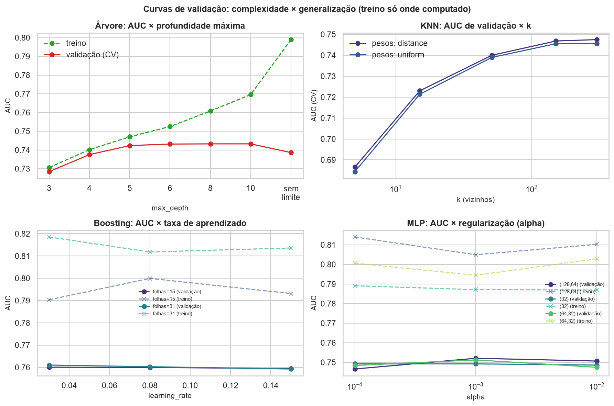
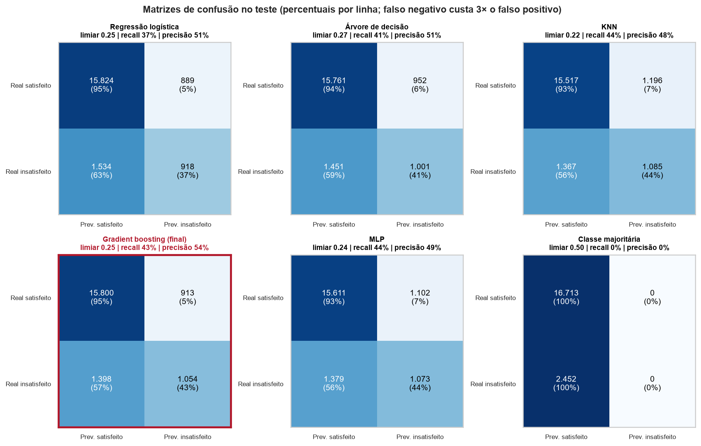
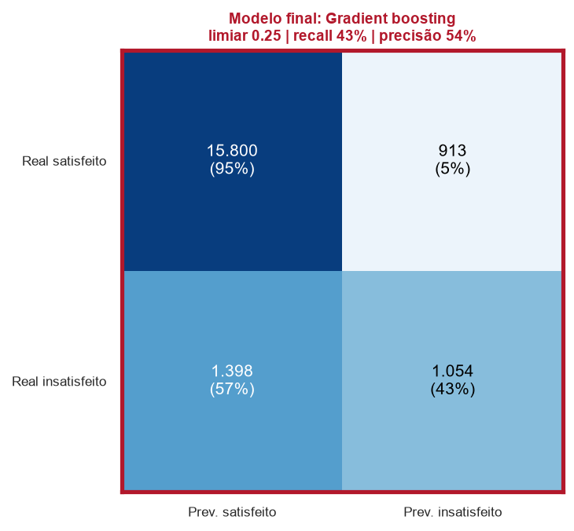
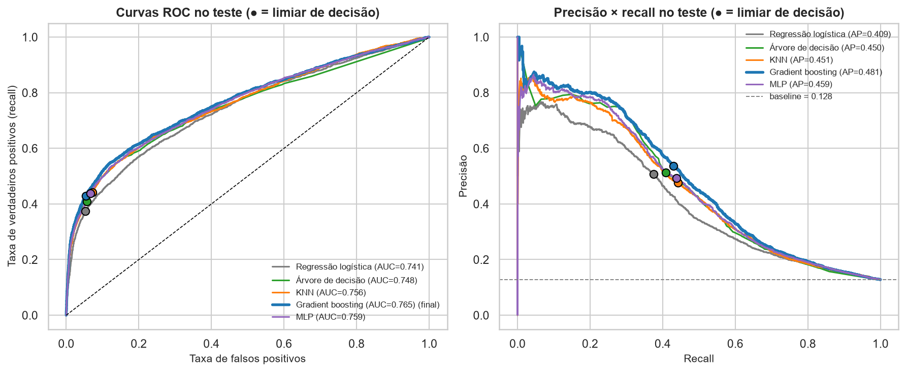
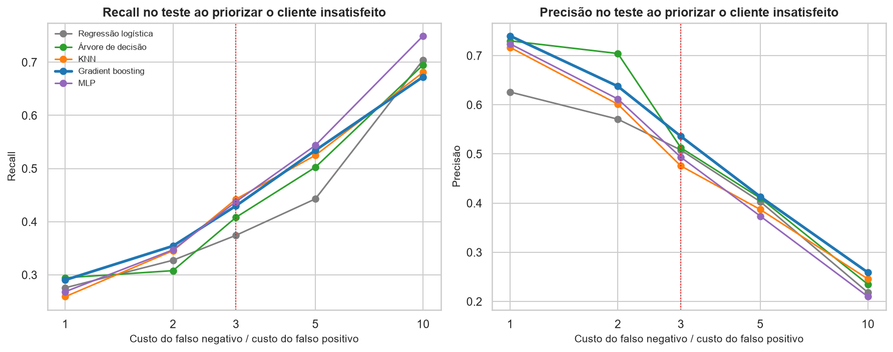
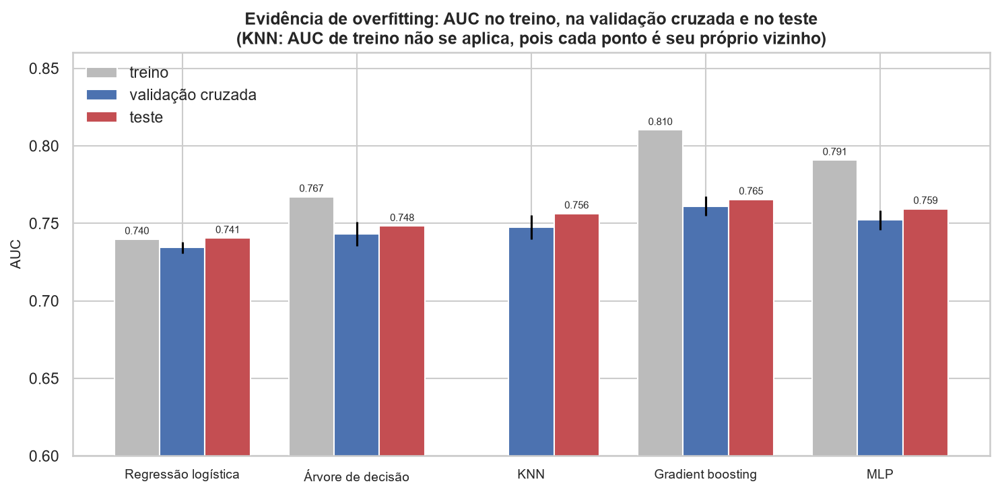
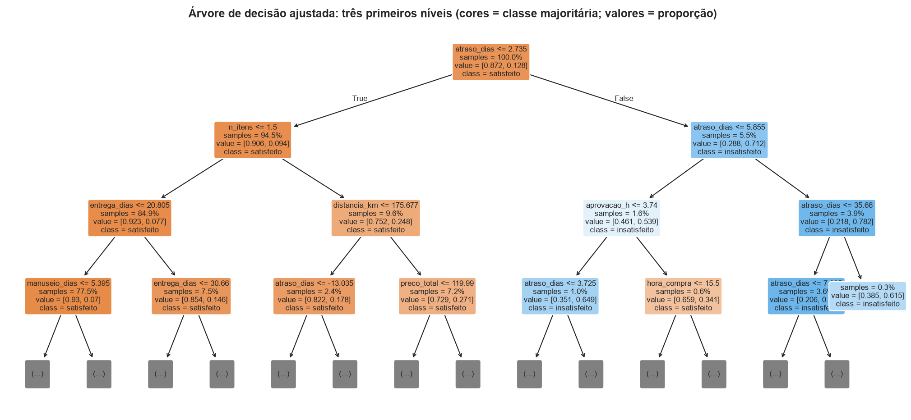

# Relatório de modelos supervisionados

**Tema:** predição de insatisfação do cliente no Olist (nota 1-2), em substituição ao tema de evasão, conforme a OBS da atividade.
**Pergunta central:** *qual modelo apresenta o desempenho mais adequado e que evidências sustentam essa escolha?*

> **Resposta curta:** o modelo escolhido é **Gradient boosting** (★). Pelo critério declarado antes de olhar o teste, ele tem o maior AUC de validação cruzada e é o único dentro de 1 erro-padrão do melhor.
> Com o falso negativo custando 3× o falso positivo, no teste identifica **42,5%** dos clientes insatisfeitos,
> com precisão de **54,0%** e AUC de **0,766**.

---

## 1. Problema e variável-alvo

* **O que se prevê:** `insatisfeito = 1` quando `review_score ≤ 2` (notas 1-2), por pedido entregue com avaliação.
* **Classe positiva:** insatisfeito. Prevalência de **12,8%** no teste (2.452 de 19.165 pedidos): classe rara.
* **Por que importa:** identificar o cliente insatisfeito permite ação corretiva (contato, compensação, correção operacional).
* **Tipos de erro:** *falso negativo* = cliente insatisfeito **não** identificado (o erro mais grave aqui); *falso positivo* = contato
  desnecessário com cliente que estava satisfeito.
* **Premissa de custo:** como o cliente insatisfeito pesa mais, adotou-se **custo(FN) = 3 × custo(FP)** para escolher o limiar de decisão.
  É uma premissa de negócio **não calibrada com custos reais**; por isso há uma análise de sensibilidade (razões de 1 a 10) na Seção 4.5.

## 2. Estratégia de amostragem e validação

* **Holdout:** divisão estratificada 80/20 (semente 42): **76.659** pedidos de treino e **19.165** de teste, com a mesma
  proporção de positivos (12,8% / 12,8%). É a mesma partição usada em todo o pipeline.
* **O teste fica reservado:** hiperparâmetros, limiar de decisão e escolha do modelo usam **apenas o treino** (validação cruzada). O teste é usado
  uma vez, para a avaliação final.
* **k-fold estratificado (k = 5):** dentro do treino, cada dobra preserva a proporção de positivos. Estratificar é essencial com classe rara
  (12,8%): sem isso, dobras com poucos positivos tornariam AUC e recall instáveis.
* **Comparação justa:** mesmas dobras e mesma semente para todos os modelos; mesmo critério de seleção de hiperparâmetros (AUC de CV);
  mesma regra de limiar; pré-processamento **dentro** do pipeline (imputação, escala e one-hot ajustados apenas no treino de cada dobra,
  sem vazamento). Escala só para os modelos sensíveis a ela (regressão logística, KNN e MLP).
* **Limiar de decisão:** em vez do padrão 0,5, é o que **minimiza o custo esperado** (FN = 3 × FP) nas previsões fora-da-dobra do treino.

## 3. Modelos e hiperparâmetros

| Modelo              | Hiperparâmetros avaliados                                                                                                           |   Configurações |
|:--------------------|:------------------------------------------------------------------------------------------------------------------------------------|----------------:|
| Regressão logística | `C` ∈ {0.01, 0.1, 1.0, 10.0}                                                                                                        |               4 |
| Árvore de decisão   | `criterion` ∈ {gini, entropy}; `max_depth` ∈ {3, 4, 5, 6, 8, 10, sem limite}; `min_samples_leaf` ∈ {20, 50, 100, 200}               |              56 |
| KNN                 | `n_neighbors` ∈ {5, 15, 51, 151, 301}; `weights` ∈ {uniform, distance}; `pre` ∈ {todas (19 variáveis), selecionadas (11 variáveis)} |              20 |
| Gradient boosting   | `learning_rate` ∈ {0.03, 0.08, 0.15}; `max_leaf_nodes` ∈ {15, 31}; `min_samples_leaf` ∈ {20, 100}                                   |              12 |
| MLP                 | `alpha` ∈ {0.0001, 0.001, 0.01}; `hidden_layer_sizes` ∈ {(32), (64,32), (128,64)}                                                   |               9 |

**Valores escolhidos** (maior AUC médio de validação cruzada; o ajuste final usa todo o treino):

| Modelo              | Valores escolhidos                                                       | No limite da grade?         | AUC CV        |   Busca (s) |
|:--------------------|:-------------------------------------------------------------------------|:----------------------------|:--------------|------------:|
| Regressão logística | `C=0.1`                                                                  | —                           | 0.7344±0.0035 |       18.80 |
| Árvore de decisão   | `criterion=gini`, `max_depth=10`, `min_samples_leaf=200`                 | max_depth, min_samples_leaf | 0.7433±0.0077 |      141.60 |
| KNN                 | `n_neighbors=301`, `weights=distance`, `pre=selecionadas (11 variáveis)` | n_neighbors                 | 0.7475±0.0076 |      283.20 |
| Gradient boosting   | `learning_rate=0.03`, `max_leaf_nodes=31`, `min_samples_leaf=20`         | learning_rate               | 0.7603±0.0066 |      164.50 |
| MLP                 | `alpha=0.001`, `hidden_layer_sizes=(128,64)`                             | —                           | 0.7521±0.0064 |      178.10 |

* **KNN:** k controla o viés-variância (k pequeno = decisão local e ruidosa; k grande = suavização). A representação das variáveis (todas × selecionadas pela etapa `select`) entrou como hiperparâmetro.
* **Árvore:** a complexidade é controlada por `max_depth` e `min_samples_leaf`; a opção "sem limite" foi incluída para expor o overfitting.
* **Ensemble:** o `HistGradientBoosting` é um ensemble de árvores rasas em sequência (boosting), o que atende ao item de ensembles do enunciado.
* **MLP:** compararam-se arquiteturas (tamanho e profundidade) e regularização L2 (`alpha`), com parada antecipada.
* **Atenção:** em Árvore de decisão: max_depth, min_samples_leaf; KNN: n_neighbors; Gradient boosting: learning_rate o valor escolhido está no limite da grade; pode haver melhor valor fora dela.

Todas as configurações avaliadas, com média e desvio da CV: `reports/tables/tab22_hiperparametros_avaliados.csv`.



*Figura: Curvas de validação: complexidade × generalização*

## 4. Avaliação dos modelos

### 4.1. Tabela comparativa (teste, limiar de custo 3:1)

| Modelo                        | Limiar   | Acurácia   | Precisão   | Recall   | F1    | AUC (IC95% bootstrap)   |
|:------------------------------|:---------|:-----------|:-----------|:---------|:------|:------------------------|
| Regressão logística           | 0,25     | 0,874      | 0,508      | 0,374    | 0,431 | 0,741 [0,729–0,752]     |
| Árvore de decisão             | 0,27     | 0,875      | 0,513      | 0,408    | 0,454 | 0,748 [0,736–0,760]     |
| KNN                           | 0,22     | 0,866      | 0,476      | 0,442    | 0,458 | 0,756 [0,746–0,767]     |
| Gradient boosting ★           | 0,25     | 0,880      | 0,540      | 0,425    | 0,476 | 0,766 [0,754–0,778]     |
| MLP                           | 0,24     | 0,871      | 0,493      | 0,438    | 0,464 | 0,759 [0,748–0,770]     |
| Classe majoritária (baseline) | 0,50     | 0,872      | 0,000      | 0,000    | 0,000 | 0,500                   |

Líderes por métrica: **acurácia**: Gradient boosting (0,880); **precisão**: Gradient boosting (0,540); **recall**: KNN (0,442); **F1**: Gradient boosting (0,476); **AUC**: Gradient boosting (0,766).
**Nenhum modelo lidera todas as métricas**: a escolha depende de qual erro pesa mais.
Métricas complementares (PR-AUC, Brier skill, ECE, custo médio, F2) estão em `tab24_comparacao_modelos.csv`.

### 4.2. A acurácia sozinha é suficiente?

Não. Com 12,8% de positivos, o classificador que **sempre prevê "satisfeito"** acerta **87,2%** e não identifica nenhum insatisfeito (recall 0).

| Modelo              | Acurácia @0,5   | Recall @0,5   | Acurácia @custo 3:1   | Recall @custo 3:1   |
|:--------------------|:----------------|:--------------|:----------------------|:--------------------|
| Regressão logística | 0,884           | 0,170         | 0,874                 | 0,374               |
| Árvore de decisão   | 0,896           | 0,294         | 0,875                 | 0,408               |
| KNN                 | 0,889           | 0,195         | 0,866                 | 0,442               |
| Gradient boosting   | 0,896           | 0,296         | 0,880                 | 0,425               |
| MLP                 | 0,893           | 0,262         | 0,871                 | 0,438               |
| Classe majoritária  | 0,872           | 0,000         | —                     | —                   |

No limiar de custo, a acurácia dos modelos fica entre **0,866 e 0,880**, praticamente a do classificador trivial
(0,872); em **2 de 5** modelos ela é menor ou igual à dele. Ao priorizar o cliente insatisfeito o limiar cai e a
acurácia diminui (média de 0,892 com limiar 0,5 para 0,873): é o preço de capturar mais insatisfeitos.
Por isso a acurácia **não** distingue um modelo útil de um inútil e não pode ser o critério de escolha.

### 4.3. Matrizes de confusão e tipos de erro



*Figura: Matrizes de confusão no teste*

| Modelo              | VP    | FN    | FP    | VN     | Insatisfeitos identificados   | Contatos desnecessários por acerto   |
|:--------------------|:------|:------|:------|:-------|:------------------------------|:-------------------------------------|
| Regressão logística | 918   | 1.534 | 889   | 15.824 | 37,4%                         | 1,0                                  |
| Árvore de decisão   | 1.001 | 1.451 | 952   | 15.761 | 40,8%                         | 1,0                                  |
| KNN                 | 1.085 | 1.367 | 1.196 | 15.517 | 44,2%                         | 1,1                                  |
| Gradient boosting ★ | 1.042 | 1.410 | 886   | 15.827 | 42,5%                         | 0,9                                  |
| MLP                 | 1.073 | 1.379 | 1.102 | 15.611 | 43,8%                         | 1,0                                  |

* Menos falsos negativos (menos insatisfeitos perdidos): **KNN** (1.367).
* Menos falsos positivos (menos contatos desnecessários): **Gradient boosting** (886).
* Modelo final: 1.410 insatisfeitos não identificados e 886 contatos desnecessários.



*Figura: Matriz de confusão do modelo final*

### 4.4. ROC e AUC



*Figura: Curvas ROC e precisão × recall no teste*

A AUC não depende de limiar e resume a separação entre as classes. Os intervalos de confiança (bootstrap do teste, 300 reamostras) mostram
quais diferenças são reais. Diferença de AUC contra o modelo final: Regressão logística -0,026 (significativa); Árvore de decisão -0,018 (significativa); KNN -0,010 (significativa); MLP -0,007 (significativa).
O modelo de maior AUC é o modelo final.
Os AUCs dos 5 modelos ficam numa faixa estreita (0,741–0,766): o teto parece vir da informação disponível nas
variáveis, e não da família de algoritmo.

### 4.5. Precisão × recall: qual pesa mais?

Como o cliente insatisfeito pesa mais, o recall é priorizado, mas **a precisão não pode ser ignorada**: cada contato desnecessário tem custo.
O limiar sai do custo esperado, e a tabela mostra como recall e precisão mudam com a razão de custo (1 = erros equivalentes; 10 = FN muito mais grave):

| Modelo              | FN=1×FP (recall / precisão)   | FN=3×FP (recall / precisão)   | FN=10×FP (recall / precisão)   |
|:--------------------|:------------------------------|:------------------------------|:-------------------------------|
| Regressão logística | 0,28 / 0,63                   | 0,37 / 0,51                   | 0,70 / 0,22                    |
| Árvore de decisão   | 0,29 / 0,73                   | 0,41 / 0,51                   | 0,69 / 0,23                    |
| KNN                 | 0,26 / 0,72                   | 0,44 / 0,48                   | 0,68 / 0,25                    |
| Gradient boosting ★ | 0,29 / 0,73                   | 0,42 / 0,54                   | 0,66 / 0,28                    |
| MLP                 | 0,27 / 0,72                   | 0,44 / 0,49                   | 0,75 / 0,21                    |



*Figura: Sensibilidade à razão de custo FN/FP*

### 4.6. Generalização e overfitting

| Modelo              | AUC treino   | AUC CV      | AUC teste   | Treino − CV   | CV − teste   | Overfitting?                        |
|:--------------------|:-------------|:------------|:------------|:--------------|:-------------|:------------------------------------|
| Regressão logística | 0,740        | 0,734±0,004 | 0,741       | 0,005         | -0,006       | não                                 |
| Árvore de decisão   | 0,767        | 0,743±0,008 | 0,748       | 0,024         | -0,005       | não                                 |
| KNN                 | —            | 0,747±0,008 | 0,756       | —             | -0,009       | n/a (treino inclui o próprio ponto) |
| Gradient boosting   | 0,812        | 0,760±0,007 | 0,766       | 0,052         | -0,006       | treino > CV, mas generaliza         |
| MLP                 | 0,791        | 0,752±0,006 | 0,759       | 0,039         | -0,007       | treino > CV, mas generaliza         |



*Figura: AUC no treino, na validação cruzada e no teste*

* Maior diferença |validação − teste| em AUC: **0,009** — os resultados da validação se mantêm no teste.
* Nenhum modelo perde desempenho entre a validação e o teste: **não há evidência de overfitting que prejudique a generalização**.
* **Gradient boosting, MLP**: AUC de treino acima do de CV (diferença > 0,03), comportamento esperado de modelos flexíveis, sem prejuízo no teste.
* **KNN:** o AUC de treino não é interpretável (cada ponto é seu próprio vizinho; com pesos por distância dá 1,0), então a generalização do KNN é avaliada só por CV × teste.

### 4.7. O ensemble melhora em relação à árvore individual?

| Métrica     | Árvore de decisão   | Gradient boosting   | Diferença   |
|:------------|:--------------------|:--------------------|:------------|
| Acurácia    | 0,875               | 0,880               | +0,006      |
| Precisão    | 0,513               | 0,540               | +0,028      |
| Recall      | 0,408               | 0,425               | +0,017      |
| F1          | 0,454               | 0,476               | +0,021      |
| AUC (teste) | 0,748               | 0,766               | +0,018      |

O boosting supera a árvore em AUC (+0.018, diferença significativa).
Em troca, perde a leitura direta das regras.



*Figura: Árvore de decisão: três primeiros níveis*

```
|--- atraso_dias <= 2.74
|   |--- n_itens <= 1.50
|   |   |--- entrega_dias <= 20.80
|   |   |   |--- manuseio_dias <= 5.39
|   |   |   |   |--- truncated branch of depth 7
|   |   |   |--- manuseio_dias >  5.39
|   |   |   |   |--- truncated branch of depth 7
|   |   |--- entrega_dias >  20.80
|   |   |   |--- entrega_dias <= 30.66
|   |   |   |   |--- truncated branch of depth 7
|   |   |   |--- entrega_dias >  30.66
|   |   |   |   |--- truncated branch of depth 3
|   |--- n_itens >  1.50
|   |   |--- distancia_km <= 175.68
|   |   |   |--- atraso_dias <= -13.03
|   |   |   |   |--- truncated branch of depth 2
|   |   |   |--- atraso_dias >  -13.03
|   |   |   |   |--- truncated branch of depth 5
|   |   |--- distancia_km >  175.68
|   |   |   |--- preco_total <= 119.99
|   |   |   |   |--- truncated branch of depth 6
|   |   |   |--- preco_total >  119.99
|   |   |   |   |--- truncated branch of depth 7
|--- atraso_dias >  2.74
|   |--- atraso_dias <= 5.86
|   |   |--- aprovacao_h <= 3.74
|   |   |   |--- atraso_dias <= 3.73
|   |   |   |   |--- class: 1
|   |   |   |--- atraso_dias >  3.73
|   |   |   |   |--- truncated branch of depth 2
|   |   |--- aprovacao_h >  3.74
|   |   |   |--- hora_compra <= 15.50
|   |   |   |   |--- class: 0
|   |   |   |--- hora_compra >  15.50
|   |   |   |   |--- class: 0
|   |--- atraso_dias >  5.86
|   |   |--- atraso_dias <= 35.66
|   |   |   |--- atraso_dias <= 7.92
|   |   |   |   |--- truncated branch of depth 3
|   |   |   |--- atraso_dias >  7.92
|   |   |   |   |--- truncated branch of depth 5
|   |   |--- atraso_dias >  35.66
|   |   |   |--- class: 1
```

### 4.8. Vantagens e limitações observadas

| Modelo              | Vantagens                                                                 | Limitações observadas                                                                                    |
|:--------------------|:--------------------------------------------------------------------------|:---------------------------------------------------------------------------------------------------------|
| Regressão logística | simples, rápido, interpretável (odds ratio)                               | linear: não captura o efeito de limiar do atraso; AUC teste 0,741                                        |
| Árvore de decisão   | regras legíveis; captura limiares e interações; sem escala                | instável e propensa a overfitting sem limite de profundidade (ver curva); AUC teste 0,748                |
| KNN                 | sem treino explícito; poucos hiperparâmetros                              | sensível à dimensionalidade (one-hot), exige k alto, predição lenta (4,3 s no teste) e sem interpretação |
| Gradient boosting   | melhor equilíbrio desempenho/custo; lida com não linearidade e categorias | menos interpretável (exige SHAP/importância); mais hiperparâmetros                                       |
| MLP                 | flexível; predição rápida                                                 | sem interpretação direta; varia com a semente (AUC teste 0,751–0,760 em 3 sementes)                      |

## 5. Escolha do modelo final

**Critério (definido antes de ver o teste):** entre os modelos cujo AUC médio de CV está a até 1 erro-padrão do melhor
(Gradient boosting: 0,7603; 1 EP = 0,0029), escolher o de **menor custo esperado** em CV (FN = 3 × FP).

| Modelo              | AUC CV   | Dentro de 1 erro-padrão do melhor   | Custo esperado em CV (por cliente)   |
|:--------------------|:---------|:------------------------------------|:-------------------------------------|
| Regressão logística | 0,7344   | não                                 | 0,2889                               |
| Árvore de decisão   | 0,7433   | não                                 | 0,2769                               |
| KNN                 | 0,7475   | não                                 | 0,2810                               |
| Gradient boosting ★ | 0,7603   | sim                                 | 0,2714                               |
| MLP                 | 0,7521   | não                                 | 0,2774                               |

Só o Gradient boosting fica dentro de 1 erro-padrão do melhor; por isso o desempate por custo não foi necessário.

**Escolhido: Gradient boosting.** Evidências:

* **Validação:** AUC de CV 0,760 ± 0,007; **teste** 0,766 [0,754–0,778].
* **Erros no teste:** recall 0,425 [0,402–0,443] e precisão 0,540 [0,518–0,564].
* **Custo médio no teste** (FN = 3 × FP): 0,2669 por cliente, o menor entre os modelos.
* **Referência de custo:** não agir custa 0,384 por cliente (todos os insatisfeitos são falsos negativos) e contatar todos custa 0,872; o modelo final reduz o custo em **30,5%** frente a não agir.
* **Generalização:** diferença treino − CV de 0,052 e CV − teste de -0,006.
* **Diferenças para os demais:** o AUC do modelo final é maior em 0,007–0,026 de AUC; o IC95% pareado exclui zero para Regressão logística, Árvore de decisão, KNN, MLP. São diferenças **pequenas em termos práticos**: por isso a escolha também se apoia em erros, custo e interpretabilidade, e não só no AUC.
* **Não é o de maior acurácia:** o modelo final também tem a maior acurácia.

## 6. Limitações e próximos passos

* **Custo assumido:** a razão 3:1 é premissa; com custos reais (contato, compensação, perda do cliente) o limiar e o modelo podem mudar. Veja a sensibilidade na Seção 4.5.
* **Um único holdout:** o teste dá uma estimativa; o intervalo por bootstrap só captura a variação de amostragem **do teste**, não a variabilidade do treino.
* **Grades finitas:** busca em grade com poucos valores; há hiperparâmetros no limite da grade (Árvore de decisão: max_depth, min_samples_leaf; KNN: n_neighbors; Gradient boosting: learning_rate).
* **Seleção de variáveis:** a representação "selecionadas" do KNN usa um consenso calculado em todo o treino, o que cria um vazamento leve entre as dobras de CV (não alcança o teste).
* **Estabilidade temporal:** na etapa `model`, a validação temporal do modelo principal deu AUC 0,690 (contra 0,766 no holdout aleatório). A comparação deste relatório usa o holdout aleatório e **não** mede esse efeito.
* **Atraso realizado:** os modelos usam `atraso_dias` e `entrega_dias`, só conhecidos na entrega; para alerta **antes** da entrega o desempenho cai (ver relatório principal).
* **Calibração:** limiares de custo pressupõem probabilidades razoavelmente calibradas; ECE por modelo em `tab24_comparacao_modelos.csv`.
* **Próximos passos:** recalibrar probabilidades, buscar em grades mais finas (busca aleatória) nos modelos com hiperparâmetro na borda,
  repetir a CV com várias sementes, validar com corte temporal e usar custos reais para definir o limiar.

*Artefatos:* `reports/tables/tab22` a `tab27`, `reports/figures/fig21` a `fig27`, `outputs/resultados_modelos_supervisionados.json`, `outputs/modelo_supervisionado_final.joblib`.
